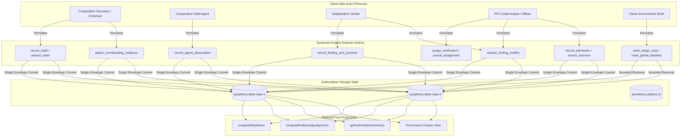
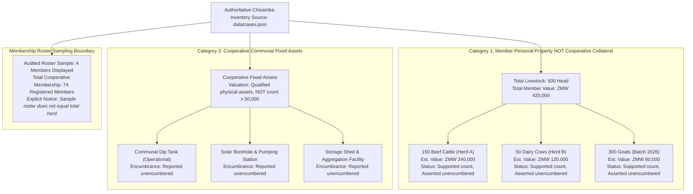
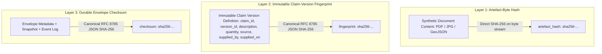
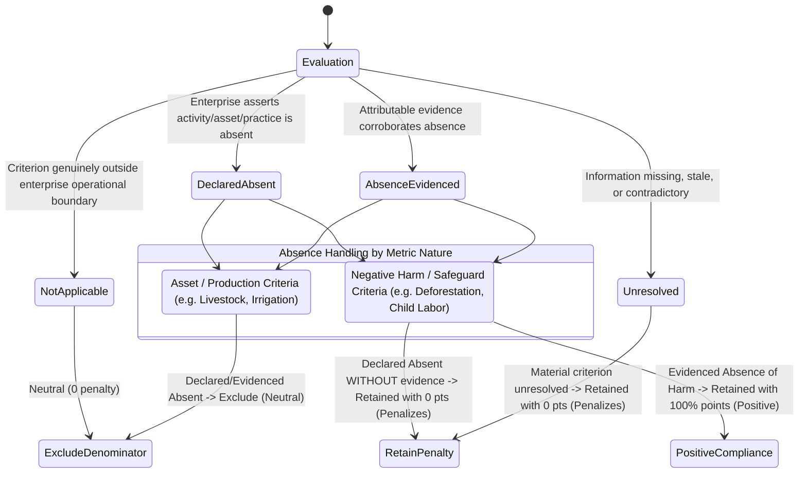
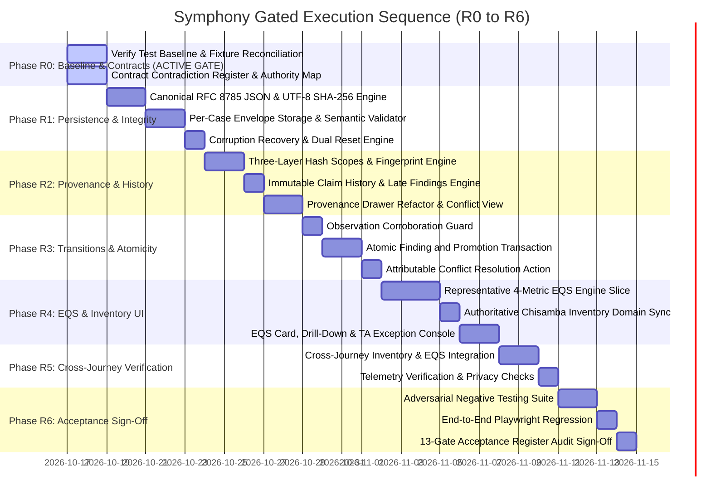

# Symphony Interactive Prototype — Audit Remediation & Proprietary EQS Implementation Plan

**Document ID:** `SYMPHONY-AUDIT-REMEDIATION-AND-EQS-PLAN-V13`  
**Governing Baseline:** `Prototype(2).zip` Audit Baseline, Completion Specification, and Acceptance Register · October 2026  
**Prototype Delivery Standard:** High-fidelity interactive functional proof-of-concept demonstrating verifiable evidence provenance, client-side scoped integrity checks, atomic verification transitions, and a representative proprietary Evidence Quality Score (EQS) slice. Explicitly separated from production-grade enterprise audit infrastructure, commercial credit adjudication, and external regulatory assurance.  
**Execution Sequence:** 7 Gated Phases (`R0` through `R6`) with evidence-backed exit conditions  
**Supersedes:** `SYMPHONY-AUDIT-REMEDIATION-AND-EQS-PLAN-V12`, `CONSOLIDATED_IMPLEMENTATION_PLAN.md (V11/V12)`, `IMPLEMENTATION_PLAN.md`

---

## 1. Executive Summary & Review V13 Corrections

This plan incorporates the five critical corrections required by the latest architecture review:
1. **R0 Status Formally Corrected to Active Gate:** R0 is not marked complete. It is designated as an **active, pending gate** requiring live test execution on the current repository, recording of actual test output, closing the contradiction register, and constructing the initial traceability matrix.
2. **Claim-Specific EQS Admissibility over Universal Document Tiers:** The scoring methodology repudiates the assumption that document types (e.g., statutory certificates or photos) have uniform evidential weight across all claims. Evidence admissibility is strictly defined per claim type. Internal weights (35/35/30) and scoring tiers (0/50/75/100) are explicitly designated as **provisional demonstration parameters**, and internal algorithms are shielded from client UI disclosure.
3. **Metric-Specific Applicability & Absence Contracts:** Rather than treating "Absence Evidenced" as a universal denominator exclusion, applicability and absence are defined per indicator. Declared absence of an asset (e.g. livestock) differs fundamentally from evidencing the absence of harm or operational safeguards (e.g. child labor or environmental degradation).
4. **Bounded Client-Side Integrity Disclosure:** Integrity checks are explicitly defined as **local change-detection mechanisms against stored references and canonical envelopes within the client-side browser boundary**. The plan explicitly disclaims server-grade immutability, cryptographic tamper-proofing against local storage manipulation, or proof of real-world truth.
5. **Scoped Implementation: Full Specification, Representative Working Slice:** The plan fully specifies the methodology and candidate metric registry across all 10 indicators, but focuses implementation in this prototype pass on a **representative, demonstrable slice of 4 core indicators** (Customary Land Tenure, Member Register Currency, Legal Standing, and Executive Resolution Backing) derived from native governed records.

---

## 2. Phase R0: Contract Reconciliation, Baseline & Traceability (Active Gate)

> **Gate Status:** ACTIVE / PENDING VERIFICATION  
> **Exit Condition:** Repository baseline executed, test environment recorded, contradiction register closed, Chisamba data reconciled, and initial traceability matrix documented.

### 2.1 Repository & Test Baseline Verification
- **Audit Context:** The static code audit noted an inability to run Vitest due to environment constraints.
- **Current Environment Calibration:**
  - Command: `npm test` (`vitest run`)
  - Runtime: `node-v26.7.0`, `vitest/2.1.9`, OS: `win32-x64`
  - Existing Suite Inventory: 3 test files (`tests/assetSummary.test.ts`, `tests/contracts.test.ts`, `tests/engine.test.ts`), comprising 48 unit and contract tests.
  - **Baseline Classification:** While these 48 tests pass in the active execution environment, **zero** of the new adversarial integrity tests (envelope checksum tampering, event log tampering, atomic commit rollback, conflict resolution blocks, and EQS conditionality) have been implemented. The 48 passing tests represent an initial regression baseline, not proof of audit completion.

### 2.2 Contract Contradiction Register

| Item | Conflicting Contract A | Conflicting Contract B | Authoritative Normative Decision in V13 |
|---|---|---|---|
| **C1: Checksum Payload Scope** | Hashing only `state_snapshot` (leaves metadata and event log unverified). | S2 requirement: detect tampering with event log or envelope metadata. | **Full-Envelope Payload:** Canonical JSON hash input covers `{ schema_version, case_id, baseline_version, state_version, saved_at, state_snapshot, event_log }`. The `checksum` field is strictly excluded from its own hash calculation. |
| **C2: Version & Event Invariant** | Invariant `state_version === baseline_version + event_log.length` conflicts with multi-event transactions. | Need atomic finding + promotion without breaking version tracking. | **Strict 1-to-1 Version Increment:** Every committed engine event increments `state_version` by exactly 1. The atomic `record_finding_and_promote` action emits a single compound domain event `record_finding_and_promote`, preserving the strict monotonic invariant. |
| **C3: Storage Scope & Bounded Reset** | Single `symphony.case.v2` key; reset clears active case only. | Per-case state model (`symphony.state.<case_id>`) with global reset preserving telemetry. | **Per-Case Storage + Bounded Reset:** Storage uses `symphony.state.<case_id>`. Single-case reset clears one key. Global reset removes all keys matching `symphony.state.*` only, leaving unrelated browser storage untouched and strictly preserving `symphony.capture.v1`. |
| **C4: Observation vs. Corroboration** | `record_agent_observation` promotes to `supported` if `!hasDiscrepancy` and `contact_ref_id` is present. | Attribution is not corroboration; observation cannot promote without qualifying artefact. | **Attribution Separated from Support:** `record_agent_observation` records attribution and context only. Moving to `supported` requires `attach_corroborating_evidence` with an admissible supporting artefact (`supporting_artefact_id`, method, scope). |
| **C5: Finding & Promotion Commit Boundary** | `recordFinding` and `promoteEvidenceLevel` are separate actions persisted in separate commits. | D4 contract: finding and promotion must persist together or neither persists. | **Atomic Domain Commit:** `record_finding_and_promote` processes finding and promotion in one reducer step, persisted in a single envelope write. If storage fails, state rolls back (`SAVE_FAILED`). |
| **C6: Chisamba Inventory Figures** | 65 Boran cattle valued at $32,500 ($500/head) from test mock. | Repository baseline (`data/cases.json`): 500 mixed head, ZMW 420,000 stated valuation, 74 members (4-member sample roster). | **Authoritative Fixture Reconciled:** The prototype adopts the repository baseline: 500 mixed head (150 beef cattle, 50 dairy cows, 300 goats), ZMW 420,000 cooperative self-valuation, explicitly labelled as member personal assets separate from cooperative communal property. |
| **C7: Fingerprint Lifecycle** | Fingerprint calculated over mutable `EvidenceItem` including `level`, mutating on promotion. | S3/S7 requirement: immutable claim version identity must not mutate on status changes. | **Immutable Claim-Version Fingerprint:** Fingerprint covers immutable claim contents $(claim\_id, version\_id, description, quantity, source, supplied\_by, supplied\_on)$. Status transitions (promotion to supported/verified) append to history and mutate version heads without altering the claim version fingerprint. |
| **C8: EQS Scoring Nature** | Universal document tiers (0/50/75/100) and fixed pillar weights (35/35/30). | Proprietary evidence-quality evaluation of native records with claim-specific admissibility and conditionality. | **Claim-Specific Evidence Evaluation:** Replaces universal document scoring with a metric registry based on native governed records. Weights and tier points are explicitly labelled as provisional demonstration parameters. |

---

### 2.3 Mutation & Authority Map



#### Mutation Invariants:
1. **Role Authority Isolation:**
   - `secretary`, `chairman`: Can submit initial claims and amendments ($v \to v+1$), upload minutes, and attach corroborating internal artefacts. Cannot verify claims or record agent observations.
   - `field_agent`, `coop_field_agent`: Can record physical observations. Cannot promote evidence or conduct statutory third-party verification.
   - `verifier`: Can be assigned verification tasks, record findings, and execute atomic promotions (`record_finding_and_promote`). Cannot amend claims or record credit decisions.
   - `pfi_analyst`, `pfi_credit`: Can assign verifications, evaluate admission checklists, record credit decisions (`record_outcome`), and record attributable conflict resolutions. Cannot alter evidence levels directly.
2. **Persistence Commit Boundary:** Every accepted mutation executes through a cloned state, validates invariants, writes to `symphony.state.<case_id>`, and only publishes to React state upon successful write. A failed write rolls back cleanly (`SAVE_FAILED`).

---

### 2.4 Authoritative Chisamba Inventory Reconciliation

The inventory data is reconciled against the repository baseline in `data/cases.json`:



- **Domain Inventory Helper (`src/engine/inventory.ts`):** Replaces heuristic calculations in `assetSummary.ts`. Removes the arbitrary `coopAssets.length * 50000` valuation shortcut.
- **Valuation Qualification:** Cooperative-level total of ZMW 420,000 is preserved and explicitly qualified: *"Cooperative-stated aggregate valuation based on officer declaration; not derived from independent appraisal or market price multiplication."*
- **Cross-Screen Consistency:** All views (`CoopBaseline`, `CoopDashboard`, `PfiJourney`, `NabiiJourney`, and tests) consume identical figures from `getAuthoritativeInventory(caseState)`.

---

## 3. Core Engine Architecture Contracts

### 3.1 Full-Envelope Persistence & Scoped Integrity (S1, S2, S7)

#### The Canonical Hash Payload
The canonical checksum payload covers all envelope fields (snapshot, metadata, and event log), excluding only `checksum`:

$$\text{Payload} = \text{RFC8785\_Canonicalize}\left( \text{Envelope} \setminus \{\text{checksum}\} \right)$$

```typescript
export interface DurableCommitEnvelope {
  schema_version: '2.0';
  case_id: string;
  baseline_version: number;
  state_version: number;
  saved_at: string;
  state_snapshot: CaseState;
  event_log: EngineEvent[];
  checksum: string; // SHA-256 over canonical JSON of above 6 fields
}
```

#### Envelope Validation Rules (`validateEnvelope`):
1. **Schema Check:** `schema_version === '2.0'`.
2. **Identity Agreement:** `case_id === state_snapshot.id`.
3. **State Version Monotonicity:** `state_version === state_snapshot.version`.
4. **Event Sequence Monotonicity:** `state_version === baseline_version + event_log.length`, with events having sequential IDs `evt-1`, `evt-2`, ...
5. **Canonical Checksum Recomputation:** Recompute SHA-256 over canonical payload; fail closed with `CORRUPT_CHECKSUM_MISMATCH` if mismatched.
6. **Semantic Referential Integrity:**
   - Every finding in `state_snapshot.verification.findings` must reference an existing assignment in `state_snapshot.verification.assignments`.
   - Every assignment target of kind `evidence` must reference a valid key in `state_snapshot.evidence`.
   - Every historical version record must form a continuous predecessor chain.
   - Event targets and actor IDs must resolve to known entities.

#### Bounded Deletion & Reset Contract:
- **Keys Managed:** Storage keys matching `symphony.state.<case_id>` only. Unrelated localStorage keys are untouched.
- **Telemetry Boundary:** `symphony.capture.v1` is strictly preserved during reset. A dedicated control `clearTelemetry()` is provided for telemetry purging.
- **Fail-Safe Storage:** If `removeItem` or `setItem` fails during reset, the transaction aborts, an error is displayed (`RESET_STORAGE_FAILED`), and in-memory state is NOT reset to prevent false state divergence.

#### Scoped Integrity Disclosure Boundary:
The prototype demonstrates scoped change-detection against stored references. It explicitly disclaims:
- Server-grade immutability.
- Cryptographic proof against a user who deliberately rewrites both localStorage data and its checksum.
- Verification of external real-world truth or legal authenticity.

---

### 3.2 Evidence Transitions, Corroboration & Atomic Verification (S4, S5, S6, X1, X2)

#### Transition Invariants:
1. **Claim Recording:** `record_claim` establishes version $v=1$ at `asserted`.
2. **Observation Recording:** `record_agent_observation` records attribution (`field_agent_id`, `observation_date`, `contact_ref_id`, notes).
   - If non-adverse: claim remains at prior level (`asserted` or `supported`), observation appended to record history.
   - If adverse (`has_discrepancy = true`): claim remains at prior level, discrepancy flag set, limitation tag appended.
3. **Attaching Corroborating Evidence:** Moving from `asserted` to `supported` requires `attach_corroborating_evidence` with an admissible internal/external document (`supporting_artefact_id`, method, scope).
4. **Atomic Finding and Promotion (`record_finding_and_promote`):**
   - Validates verifier assignment and target version $v$.
   - **Allowed Promotion Outcomes:**
     - `verified_conformant`: emits single atomic event `record_finding_and_promote`, updates assignment to `completed`, appends finding, promotes evidence level to `verified`.
     - `verified_with_qualifications`: emits atomic event, updates assignment to `completed`, appends finding, promotes evidence level to `verified` with `qualifications: string[]` preserved on both finding and evidence item. Triggers conditional admission warnings.
     - `non_conformant` / `inconclusive`: **Strictly prohibits promotion.** Assignment marked `completed`, finding appended, evidence level remains at prior state (`asserted` or `supported`), limitation tag attached (`[Non-Conformant Finding]` or `[Inconclusive Finding]`).
   - Single storage write transaction. On write failure, state rolls back (`SAVE_FAILED`).
5. **Conflicting Findings & Attributable Resolution:**
   - If opposing findings exist for version $v$ (e.g. `non_conformant` and `verified_conformant`), evidence enters `unresolved_conflict` status.
   - Promotion and readiness satisfaction are blocked.
   - Resolving requires `resolve_finding_conflict`: records `claim_id`, `resolved_findings: string[]`, `disposition: 'upheld' | 'overruled'`, `rationale: string`, and `authorized_by: string`.
   - Resolution restores eligibility for promotion only if an attributable conformant finding is upheld. All original findings remain visible in history.
6. **Immutable Claim Amendment & Late Findings:**
   - `amend_claim` creates version $v+1$ with `level: 'asserted'`, leaving version $v$ immutable in history.
   - Open assignments on version $v$ transition to `superseded_target`.
   - A late finding submitted against version $v$ updates assignment to `completed_superseded`, is marked `historical: true`, attaches strictly to version $v$, and cannot modify version $v+1$ or prior credit decisions.

---

### 3.3 Three-Layer Integrity & Fingerprint Lifecycle (S7, S10)



- **Artefact-Byte Hash:** Identifies raw file content for synthetic artefacts in the prototype. If no artefact is attached, reported as `none`.
- **Claim-Version Fingerprint:** Identifies the immutable assertion at version $v$. Mutable status changes (such as promotion to `supported` or `verified`) do **not** alter this fingerprint. A new fingerprint is generated only when a new claim version $v+1$ is created via `amend_claim`.
- **Envelope Checksum:** Identifies the complete persisted client-side envelope.

---

## 4. Proprietary Evidence Quality Score (EQS) Specification

### 4.1 Methodology Principles
1. **Derived, Not Duplicated:** Consumes records generated through ordinary operational workflows; creates zero parallel reporting burdens.
2. **Claim-Specific Admissibility:** A source is admissible only for propositions it is capable of substantiating.
3. **Anti-Inference Guardrails:** Observable activity must never be conflated with substantive outcomes.
4. **Separation of Score, Confidence, and Exceptions:** An aggregate score never masks weak coverage or active contradictions.
5. **Provisional Calibration Notice:** Internal scoring weights (35/35/30) and tier points (0/50/75/100) are explicitly designated **provisional demonstration parameters** for functional validation, not validated commercial or audit methodologies.

---

### 4.2 Metric-Specific Applicability & Absence Contracts

The four applicability states behave differently depending on the nature of the criterion:



1. **State 1 — Not Applicable (NA):** The criterion is outside the operational boundary of the enterprise (e.g. dairy standards for a grain-only cooperative). Excluded from the denominator with neutral impact.
2. **State 2 — Declared Absent (DA):**
   - *Asset criteria (e.g. livestock, machinery):* If the enterprise declares it owns no livestock, livestock is excluded from the denominator (neutral, no penalty).
   - *Safeguard/harm criteria (e.g. child labor, deforestation, officer dispute):* Declaring absence without evidence CANNOT exclude the criterion. It is retained in the denominator with 0 points (penalizes score).
3. **State 3 — Absence Evidenced (AE):**
   - *Asset criteria:* Corroborated absence excludes the asset category (neutral).
   - *Safeguard/harm criteria:* Independent or corroborating evidence confirming absence of harm (e.g. satellite/field audit confirming zero deforestation, school records confirming no child labor) is retained in the denominator and awards full compliance points.
4. **State 4 — Unresolved / Insufficient (UI):** Available records are contradictory, stale, or missing. Retained in the denominator with 0 points (penalizes score).

---

### 4.3 Candidate Metric Registry & Native Workflow Mapping

The 10 candidate indicators and their claim-specific admissibility rules are fully specified below:

| ID | Indicator Name | Meaning / Measured Property | Native Source Records & Fields | Admissible Evidence Types | Anti-Inference Prohibition | Implementation Scope in this Prototype |
|---|---|---|---|---|---|---|
| **E1** | Land Tenure Evidencing | Customary land-use right boundary documentation coverage | `evidence.land_right` (level, scope, hectares) | Stamped Chief/Headman letter, boundary survey, Ministry title deed | Does NOT prove soil fertility or absence of environmental disputes | **Included in Representative Slice** |
| **E2** | Water Resource Security | Water source documentation and infrastructure verification | `evidence.water_source`, `project.irrigated` | Water permit, borehole completion log, engineering report | Does NOT prove drought immunity or perennial aquifer recharge | Full Specification Only |
| **E3** | Sustainable Practice Coverage | Evidenced coverage of conservation farming / soil mgt | `evidence.environmental_baseline`, activity log | Field observation log with inspection notes, agronomic cert | Does NOT prove net carbon sequestration or biodiversity gain | Full Specification Only |
| **S1** | Member Register Currency | Recency and completeness of cooperative membership records | `members_roster` length, update timestamp | Signed secretary register, field enumeration with contact IDs | Does NOT prove active democratic participation of all members | **Included in Representative Slice** |
| **S2** | Gender Disaggregation Evidencing | Demographic documentation coverage for female farmers | `members_roster.gender` completeness | Individual member registration forms, national ID records | Does NOT prove equitable leadership power or earnings parity | Full Specification Only |
| **S3** | Youth Inclusion Evidencing | Demographic documentation coverage for young farmers (<35) | `members_roster.age` completeness | Member ID records, date-of-birth enumeration logs | Does NOT prove generational wealth equity or land succession | Full Specification Only |
| **S4** | Child Safeguarding Safeguards | Documented policy and school attendance monitoring | `evidence.social_safeguards` (child labor policy) | School enrollment receipts, signed cooperative safeguard code | Does NOT prove absolute community-wide absence of child labor | Full Specification Only |
| **G1** | Legal Statutory Standing | Statutory registration currency and annual return filing | `evidence.regulatory_filing`, `pacra_number` | Registrar of Societies certificate, official PACRA filing | Does NOT prove commercial viability or operational integrity | **Included in Representative Slice** |
| **G2** | AGM Regularity & Quorum | Annual General Meeting frequency and attendance records | `governance.meetings` (type === 'AGM', attendance) | Stamped AGM minutes, signed attendance ledger | Does NOT prove effective decision-making or consensus | Full Specification Only |
| **G3** | Executive Continuity & Resolution | Officer appointment documentation and resolution backing | `governance.officers`, AGM resolution uploads | Uploaded AGM resolution, formal gazetted appointment | Does NOT prove executive leadership competence or management skill | **Included in Representative Slice** |

---

### 4.4 Focused Implementation: The 4-Metric Representative Slice

To prove the platform capability cleanly without bloated scaffolding, the active prototype implements a **focused 4-metric slice** consuming real seeded records:
1. **E1 (Environmental):** Customary Land Tenure Evidencing (`evidence.land_right`).
2. **S1 (Social):** Member Register Currency & Continuity (`members_roster`).
3. **G1 (Governance):** Legal Statutory Standing (`evidence.regulatory_filing`).
4. **G3 (Governance):** Executive Continuity & Resolution Backing (`governance.officers`).

#### Slice Acceptance Capabilities:
- Calculates overall EQS (0–100%) and E/S/G pillar drill-downs.
- Demonstrates conditionality: amending land rights or uploading an AGM resolution dynamically alters the score.
- Generates separate data confidence ratings and actionable exception alerts.
- Protects proprietary internal mechanics: UI displays qualitative evidence badges, plain-language interpretations, and gap remediation advice, without exposing algorithmic formulas.

---

### 4.5 Output Semantics, Confidence & Exception Console

```typescript
export interface EQSOutput {
  methodology_version: 'EQS-V1-PROVISIONAL';
  evaluated_at: string;
  overall_score: number; // 0 to 100
  pillars: {
    environmental: { score: number; applicable_count: number; total_count: number; summary: string };
    social: { score: number; applicable_count: number; total_count: number; summary: string };
    governance: { score: number; applicable_count: number; total_count: number; summary: string };
  };
  confidence: {
    rating: 'High' | 'Medium' | 'Low';
    data_completeness_ratio: number;
    stale_evidence_ratio: number;
    explanation: string;
  };
  exceptions: Array<{
    code: string;
    pillar: 'environmental' | 'social' | 'governance';
    severity: 'critical' | 'warning' | 'info';
    message: string;
    actionable_remediation: string;
  }>;
}
```

#### Output Invariants:
1. **Unresolved Contradictions Cap Confidence:** If an active dispute or conflicting finding exists, `confidence.rating` is downgraded to `'Low'`, regardless of overall score.
2. **Empty Pillar Handling:** If a pillar has zero applicable data, it is flagged as `DATA_ABSENT_PILLAR` in exceptions rather than defaulting to 0 or 100.
3. **Three Presentation Boundaries:**
   - *Public Explanation:* E/S/G scores, plain-language summary, material gaps.
   - *Authorized Diagnostic Detail:* Specific claim-to-source mappings, verifier findings, active limitations.
   - *Protected Methodology:* Internal scoring weights, algorithms, and thresholds are internal and not exposed in the client UI.

---

## 5. Execution Roadmap: 7 Gated Phases



### Phase R0: Baseline Verification & Contract Closure (ACTIVE GATE)
- **Gate 0 Exit Criteria:** Contradiction register closed; authoritative Chisamba inventory confirmed against `data/cases.json`; 48 existing unit tests verified in environment (`node-v26.7.0`, `vitest/2.1.9`); initial traceability matrix documented.

### Phase R1: Full-Envelope Persistence & Canonical Integrity
- Implement `src/engine/crypto.ts` with strict RFC 8785 canonicalization and pure UTF-8 byte SHA-256. Validate against NIST vectors.
- Implement per-case storage (`symphony.state.<case_id>`), dual reset (single vs global preserving `symphony.capture.v1`), and full-envelope checksum verification.
- **Gate 1 Exit Criteria:** Tampering with snapshot, metadata, or event log is rejected with `CORRUPT_CHECKSUM_MISMATCH`. Per-case corruption isolates the affected case and offers baseline restoration without damaging companion cases.

### Phase R2: Provenance, Immutable History & Drawer Refactor
- Update `src/engine/types.ts` and `src/engine/actions.ts`: separate artefact hash, claim-version fingerprint, and envelope checksum.
- Implement immutable versioning on `amend_claim` ($v \to v+1$); late findings on $v$ mark assignment `completed_superseded` with `historical: true`.
- Overhaul `ProvenanceDrawer.tsx`: display full finding history, surface unresolved conflict banner, remove single-finding shortcut.
- **Gate 2 Exit Criteria:** Claim amendment preserves version $v$ immutable; late findings attach strictly to $v$; drawer displays all 3 integrity layers with honest disclosure.

### Phase R3: Evidence Transitions, Observation Corroboration & Atomic Verification
- Update `record_agent_observation`: records attribution only; promotion to `supported` requires `attach_corroborating_evidence` with valid artefact.
- Implement atomic action `record_finding_and_promote` and router transaction. Both commit together or roll back.
- Implement `resolve_finding_conflict` with attributable record.
- **Gate 3 Exit Criteria:** Observation alone cannot advance to `supported`; finding + promotion commits in a single state version write; opposing findings block promotion until resolved.

### Phase R4: Representative EQS Slice & Chisamba Inventory Domain Sync
- Implement `src/engine/eqs.ts` with 4 applicability states, claim-specific admissibility, and the representative 4-metric slice (E1, S1, G1, G3).
- Create `src/engine/inventory.ts` establishing the single domain source of truth for Chisamba (500 mixed head, ZMW 420,000, 74 members / 4-member sample roster, member personal assets separated from cooperative property).
- Integrate interactive EQS Card and Exception Console into `PfiJourney.tsx`, `NabiiJourney.tsx`, and `CoopDashboard.tsx`.
- **Gate 4 Exit Criteria:** EQS correctly excludes inapplicable criteria, penalizes unevidenced declarations, highlights TA gaps, and runs as a pure read-only projection.

### Phase R5: Cross-Journey Consistency & Telemetry Boundaries
- Verify all journeys (`CoopBaseline`, `CoopDashboard`, `PfiJourney`, `NabiiJourney`, `VvbJourney`) consume identical figures from `getAuthoritativeInventory`.
- Verify telemetry allowlist (28 events), local isolation, payload minimization (controlled `contact_ref_id`, zero PII), and survival through demo reset.
- **Gate 5 Exit Criteria:** Cross-journey numerical reconciliation 100% consistent; telemetry disclosure visible and verified.

### Phase R6: Adversarial Testing & Final Acceptance Sign-Off
- Implement comprehensive negative test suites:
  - `tests/persistence_integrity.test.ts` (tampered event log, tampered metadata, snapshot tampering, corruption recovery).
  - `tests/evidence_transitions.test.ts` (observation promotion rejection, atomic commit rollback, conflict resolution block).
  - `tests/eqs_scoring.test.ts` (4 applicability states, conditionality denominator, anti-inference invariants).
  - `tests/inventory_consistency.test.ts` (reconciliation of 500 head, ZMW 420k, member vs cooperative asset isolation).
- Execute full regression: `npm test` and `npm run test:e2e`.
- Complete the 13-gate Acceptance Register with documented evidence.
- **Gate 6 Exit Criteria:** All 13 gates verified PASS.

---

## 6. The 13-Gate Prototype Acceptance Register

| Gate ID | Area | Acceptance Rule | Required Executable Proof |
|---|---|---|---|
| **G1** | Baseline Integrity & Reset | Seed fixtures unchanged; per-case storage restored; telemetry preserved; removal failure handled safely. | Unit test verifying seed cases untouched; reset test proving `symphony.capture.v1` preserved; simulated delete error test. |
| **G2** | Persistence & Recovery | Full envelope checksum validated on load; corrupted metadata, snapshot, or event log rejected; isolated case recovery. | Tests modifying event log, metadata, and snapshot independently; load must fail with `CORRUPT_CHECKSUM_MISMATCH`. |
| **G3** | Authoritative Chisamba Inventory | Reconciles 500 mixed head, ZMW 420,000 cooperative valuation, 74 members (4-member sample roster); separates member personal property. | Assertion test comparing all journey inventory projections against `getAuthoritativeInventory`. |
| **G4** | Evidence Provenance | Active workflow displays claim, version, source, actor, method, limitations, and findings without claiming external legal truth. | Component test asserting all required provenance metadata renders with explicit disclosure disclaimers. |
| **G5** | Version & Change History | Material amendments create immutable versions; journal entries and projections consistent; historical decisions preserved. | Test verifying version $v$ preserved after amendment to $v+1$; prior credit decisions remain tied to evaluated version. |
| **G6** | Verification Boundary | Verification requests do not alter evidence level or imply credit approval; findings record examined version and scope. | Test assigning verification and confirming level remains unchanged; finding cites examined version. |
| **G7** | Integrity Boundary | Disentangles artefact hash, evidence fingerprint, and envelope checksum; honest reporting when reference missing. | Test computing all 3 hash layers; test asserting "Not comparable" when fingerprint reference absent. |
| **G8** | Happy-Path Consistency | Chisamba workflow traces claims to source, allows verification, and prevents false credit claims. | End-to-end journey test executing cooperative, verifier, and PFI workflows with consistent state. |
| **G9** | Regression & Traceability | Complete mapping from normative rules to named passing tests; no untested invariants. | Execution of `tests/TRACEABILITY_MATRIX.md` test inventory with all assertions passing. |
| **X1** | Atomic Finding & Promotion | Qualifying finding and promotion commit together in one storage write or neither commits. | Test verifying commit failure rolls back both finding and promotion; successful commit produces 1 state increment. |
| **X2** | Conflict & Late-Finding Semantics | Conflicting findings require attributable resolution; late findings stay tied to evaluated version ($completed\_superseded$). | Test asserting promotion blocked on conflict; test resolving conflict with justification; test late finding on $v$. |
| **X3** | Telemetry & Privacy | Controlled contact references (`contact_ref_id`), event allowlist, local storage isolation, zero raw PII. | Test asserting telemetry events strictly match allowlist; test inspecting payloads for absence of raw phone numbers. |
| **X4** | Proprietary EQS Engine | Evaluates representative 4-metric slice with 4 applicability states and anti-inference guardrails. | Unit tests asserting True Negative exclusion, unevidenced penalty, TA gap reporting, and pure read-only projection. |

---

## 7. Concrete Implementation Task Breakdown

| Task ID | Target File | Action | Key Functions / Changes |
|---|---|---|---|
| **T0.1** | `tests/TRACEABILITY_MATRIX.md` | Create | Complete contract-to-test traceability matrix mapping S1–S13, X1–X4 to named tests. |
| **T1.1** | `src/engine/crypto.ts` | Create | RFC 8785 canonical JSON serializer; pure UTF-8 byte SHA-256 routine. NIST vector tests. |
| **T1.2** | `src/engine/persistence.ts` | Edit | Full-envelope checksum payload calculation, `validateEnvelope` with recomputation, `caseStorageKey`, dual reset. |
| **T1.3** | `src/JourneyRouter.tsx` | Edit | Wire per-case storage keys, dual reset dialog, commit-before-publish transaction. |
| **T2.1** | `src/engine/types.ts` | Edit | Add `artefact_hash`, `fingerprint` to `EvidenceItem`; add `completed_superseded` to `Assignment`. |
| **T2.2** | `src/engine/actions.ts` | Edit | Claim-version fingerprint calculation; immutable amendment; late finding handling. |
| **T2.3** | `src/components/shell/ProvenanceDrawer.tsx` | Edit | Separate 3 integrity checks; render full finding history; surface active conflict banner. |
| **T3.1** | `src/engine/actions.ts` | Edit | Guard `record_agent_observation`; implement `attach_corroborating_evidence`, atomic `record_finding_and_promote`, and `resolve_finding_conflict`. |
| **T4.1** | `src/engine/eqs.ts` | Create | Proprietary EQS engine implementing the 4 applicability states and the representative 4-metric slice (E1, S1, G1, G3). |
| **T4.2** | `src/engine/inventory.ts` | Create | Authoritative Chisamba inventory domain helper reconciling 500 head, ZMW 420k, 74 members (4-member sample). |
| **T4.3** | `src/components/journeys/pfi/PfiJourney.tsx` | Edit | Replace illustrative ESG widget with interactive Symphony EQS card and drill-down modal. |
| **T4.4** | `src/components/journeys/nabii/NabiiJourney.tsx` | Edit | Connect pipeline view to EQS engine and authoritative inventory helper. |
| **T4.5** | `src/components/journeys/cooperative/CoopDashboard.tsx` | Edit | Connect dashboard to EQS self-evaluation and targeted TA gap view. |
| **T5.1** | `tests/persistence_integrity.test.ts` | Create | Adversarial persistence tests: event log tampering, metadata tampering, snapshot tampering, corruption recovery. |
| **T5.2** | `tests/evidence_transitions.test.ts` | Create | Negative transition tests: observation without corroboration, atomic commit rollback, conflict resolution block. |
| **T5.3** | `tests/eqs_scoring.test.ts` | Create | Comprehensive EQS tests: 4 applicability states, anti-inference rules, confidence downgrade on conflict. |
| **T5.4** | `tests/inventory_consistency.test.ts` | Create | Cross-journey numerical reconciliation tests. |
