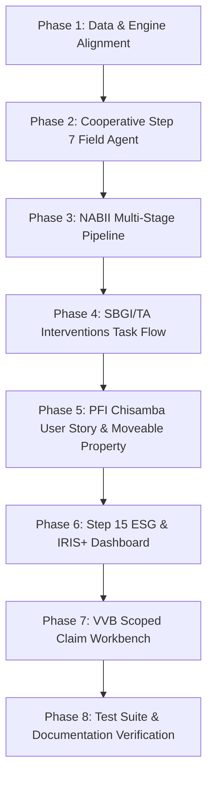

# Symphony Interactive Prototype — Implementation Plan V5
### Governed Evidence & Pipeline Infrastructure Redesign

---

> **Precedence & Authority:** This document embodies the authoritative requirements provided in user guidance, taking explicit precedence over `SYMPHONY-EXEC-PLAN-V3.md` and superseding all prior revisions (`REDESIGN_IMPLEMENTATION_PLAN-v4.md`, `REDESIGN_IMPLEMENTATION_PLAN-V2.md`).

---

## 1. Executive Summary & Core Precedence Rules

Symphony is a governed state and evidence infrastructure prototype designed for rural cooperative enterprises, institutional capital providers (PFIs), fund managers (NABII), technical assistance providers (SBGI/TA), and independent verifiers (VVBs). 

The goal of this implementation is to turn the prototype from a static presentation into an active, guided institutional infrastructure where:
1. **Economic reality is made legible without faking creditworthiness:** Enterprises have transparent, traceable, and verifiable governed records.
2. **Readiness is destination-specific:** An enterprise is never universally "ready" or "unready", but evaluated against specific financing products (Lender A, Lender B) or public program registries (NABII).
3. **Proprietary ESG Scoring with IRIS+ Taxonomy:** While arbitrary "universal credit readiness scores" remain excluded, Symphony provides an internal **Proprietary Symphony ESG Rating Methodology** alongside an **IRIS+ Compliant Metric Taxonomy** for illustrative prototype assessment.
4. **Member-level moveable property & Field Agent attribution:** Assets (livestock, movable property) can belong to individual cooperative members rather than the cooperative legal entity. Evidence is traced to a designated cooperative **Field Agent** with verified contact details, enabling flexible financial structuring (e.g. direct-to-member lending with cooperative oversight).
5. **Macro-to-Micro 10 Cooperative Cohort:** NABII's national dashboard presents high-level macroeconomic program sums, while drilling down exposes the reconciled cohort of 10 rural cooperatives.

---

## 2. Architectural & Methodological Foundations

### 2.1 Proprietary Symphony ESG Scoring & IRIS+ Compliance
- **Methodology Labeling:** Prominently labeled across all SME, NABII, and PFI views as:
  > *“Symphony Proprietary ESG Rating Methodology — Internal Prototype Metric for Illustrative Purposes (IRIS+ Compliant Taxonomy)”*
- **Scoring Framework (0–100 Scale & Tiering):**
  - **Environmental (E - 35%):** Sustainable agricultural practices, verifiable water security (solar borehole/irrigation), soil & land-use stewardship.
  - **Social (S - 35%):** Smallholder participation, gender inclusion (% women members/leaders), youth inclusion (% households led by individuals under 35 years).
  - **Governance (G - 30%):** Validated member roster, documented AGM minutes, quorum verification, officer resolution consistency, encumbrance disclosure.
  - **Composite Score & Tier:**
    - Tier A: 80–100 (High institutional/impact readiness)
    - Tier B: 60–79 (Standard eligibility, targeted gaps)
    - Tier C: 40–59 (Remediation/TA required)
    - Tier D: <40 (Early baseline)
- **IRIS+ Metric Taxonomy Mapping:**
  - `IRIS+ PI4060`: Smallholder Farmers Reached (count of active farming members)
  - `IRIS+ OI6213`: Youth-Led Households (household heads / enterprise members < 35 years)
  - `IRIS+ PI1540`: Female Governance & Membership Share (% female members and executive officers)
  - `IRIS+ PI2822`: Sustainable Land & Water Management (hectares irrigated, sustainable farming seasons)

### 2.2 Demographic Standard: Youth Definition
- **Definition:** Any individual **under 35 years of age** (`age < 35`) qualifies as youth.
- **Youth-Led Household:** A farming household where the designated primary member/head is under 35 years old.
- **Implementation in Data & Engine:**
  - Roster items include `age: number` or `birth_year`.
  - Aggregator computes `youth_count = members.filter(m => m.age < 35).length` and `% youth-led households`.

### 2.3 Lender B Product & Evaluation Fix
- **Product Definition:** Group Seasonal Facility (`destination: 'B'`).
- **Core Parameters:**
  - Request range per group: ZMW 10,000 to ZMW 50,000.
  - Term: 6 to 12 months.
  - Structure: Cooperative partitioned into peer borrower groups with group guarantees over listed movable property.
- **Evaluation Requirements (B1–B8):**
  - `B1`: Current legal registration (min_level: `verified`).
  - `B2`: Governance records & minutes (min_level: `supported`).
  - `B3`: Member register with identity checked (min_level: `verified`).
  - `B4`: Group structure defined (min_level: `supported`).
  - `B5`: Moveable asset inventory for group guarantee (min_level: `supported`).
  - `B6`: Farming history (min 1 season, min_level: `supported`).
  - `B7`: Request fit (per-group request structure, amount ZMW 10k–50k, term 6–12 months).
  - `B8`: Off-take arrangement (assessment time / supported).
- **The Chisamba Case Dynamic:**
  - Chisamba Cooperative (`case-1`) applies as a single entity for ZMW 300,000 over 24 months.
  - Result under Lender A: **Rejected / Not Ready** (missing verifiable water source, equipment quotation, and off-take agreement).
  - Result under Lender B: **Rejected / Not Ready** (fails B7 because structure is single cooperative entity rather than per-group, and request exceeds per-group limits).
  - **Resolution Opportunity:** Moveable property (livestock) exists at member level, verified by a traceable Field Agent, allowing the loan officer to propose a structured direct-to-member loan.

### 2.4 The 10 Cooperative Model & National Reconciliation
- **Macro National Level (NABII Dashboard):**
  - National agricultural pipeline aggregates show national scope (e.g. 50 enterprises registered nationally, ZMW 14.2M pipeline demand, 7,200 smallholder farmers).
- **Cohort Drilldown:**
  - Drilling into the active regional cohort (e.g., Central Province Agriculture Cohort) reconciles directly to the **10 active cooperatives**:
    1. `case-1`: Chisamba Farmers Cooperative Society (Central Province)
    2. `case-2`: Mkushi Growers Cooperative (Central Province)
    3. `case-3`: Lufwanyama Women's Agribusiness Cooperative (Copperbelt)
    4. `case-4`: Kapiri Maize Producers Group (Central Province)
    5. `case-5`: Mumbwa Irrigators Cooperative (Central Province)
    6. `case-6`: Katete Youth Farmers Cooperative (Eastern Province)
    7. `case-7`: Choma Dairy Cooperative Society (Southern Province)
    8. `case-8`: Serenje Smallholders Cooperative (Central Province)
    9. `case-9`: Mpongwe Grain & Oilseed Cooperative (Copperbelt)
    10. `case-10`: Monze Green Livestock & Crop Cooperative (Southern Province) — *New 10th case*

---

## 3. The Four Redesigned Journeys

### 3.1 Journey 1: NABII (Manage the Pipeline)
**Progression:**
`Programme` ➔ `Cohort` ➔ `Readiness Distribution` ➔ `Identify Needs` ➔ `Coordinate Support` ➔ `Discoverable Pipeline`

1. **Step 1 — Programme Overview & National Distribution:**
   - Display national summary cards (50 national enterprises, overall pipeline value, ESG impact coverage).
   - Display distribution bar across clearly defined states:
     - `Registered / Baseline`
     - `Needs Identified / TA Assigned`
     - `Remediation Complete`
     - `Assessment-Ready (Lender A)`
     - `Assessment-Ready (Lender B)`
     - `Discoverable in Registry`
2. **Step 2 — Cohort Drilldown (10 Cooperatives):**
   - Selecting a distribution state filters the cohort table down to the exact matching cooperatives.
   - Reconciles aggregate counts against the 10 cooperatives.
3. **Step 3 — Enterprise Dossier & Gap Inspection:**
   - Selecting an enterprise opens its dossier.
   - Shows why it is in its current state (e.g. Chisamba: Lender A blocked by A8/A9/A10; Lender B blocked by B4/B7).
   - Shows the proprietary ESG Scorecard with IRIS+ metrics.
4. **Step 4 — Coordinate Support & Interventions:**
   - NABII coordinates TA support (assigns TA provider for governance or water evidence).
   - Once support/evidence is logged, the enterprise state visibly transitions, and the pipeline refreshes dynamically.

---

### 3.2 Journey 2: SBGI / TA (Manage Interventions)
**Progression:**
`Intervention Queue` ➔ `Select Enterprise` ➔ `Inspect Gap` ➔ `Record Assignment` ➔ `Review Evidence of Completion` ➔ `Reassess Readiness`

1. **Step 1 — Intervention Queue:**
   - TA provider sees list of enterprises flagged by NABII or lenders needing technical assistance.
   - Highlights gap category: Governance Remediation, Production Records, Environmental Baseline, Collateral Documentation.
2. **Step 2 — Select Enterprise & Inspect Gap:**
   - Detailed inspection of the unfulfilled requirement and source evidence limitation.
   - Explains what evidence is required to close the gap.
3. **Step 3 — Record Assignment & Scope:**
   - TA provider logs intervention assignment (assigned specialist, start date, budget, intervention scope).
4. **Step 4 — Review Evidence of Completion:**
   - TA specialist logs the completed remediation action and attaches completion evidence (e.g., ratified AGM minutes with proper quorum, verified water yield test, or livestock inventory).
5. **Step 5 — Reassess Readiness:**
   - Symphony re-evaluates the case dossier.
   - **Crucial Rule:** TA completion updates the gap to `supported` (or closes operational deficiencies), but does *not* automatically fabricate independent verification (`verified`). If a requirement specifically demands independent 3rd-party verification, it flags that a VVB task is now unlocked.

---

### 3.3 Journey 3: PFI (Discover and Assess)
**Progression:**
`Discover` ➔ `Inspect` ➔ `Query or Verify` ➔ `Assess` ➔ `Decide` ➔ `Monitor`

#### The Complete Chisamba Loan Officer User Story:
1. **Discover & Select:**
   - Loan officer logs into PFI Workspace (e.g., Zanaco / Commercial Agri-Desk).
   - Inspects portfolio of discoverable agricultural enterprises and selects **Chisamba Farmers Cooperative Society** (`case-1`).
2. **Assessment Against Products:**
   - **Under Lender A:** Single cooperative facility (ZMW 300,000). The automated evaluation engine indicates **Not Ready / Rejected** (missing verifiable water borehole, equipment quotation, and commercial off-take contract).
   - **Under Lender B:** Group seasonal facility. The automated evaluation engine indicates **Not Ready / Rejected** (single structure fails group criterion B7, and no cooperative-level fixed collateral exists).
3. **Drilldown to Moveable Property & Member Ownership:**
   - Loan officer inspects the collateral and asset evidence.
   - Discovers that while the cooperative has no titled real estate, the roster contains substantial **Moveable Property (Livestock / Cattle / Goats)** totaling over ZMW 420,000.
   - Drills down into the asset inventory and discovers: **This property is owned by individual members, not the cooperative legal entity.**
4. **Traceable Field Agent Verification:**
   - Loan officer inspects the asset verification record.
   - Evidence details reveal it was physically verified by the cooperative's designated **Field Agent**:
     - **Name:** Gift Mulenga (Cooperative Field Officer & Member)
     - **Phone:** `+260 97 712 3456`
     - **Verification Date:** 2026-09-15
     - **Physical Location / GPS:** Chisamba West Agricultural Camp (`-14.9812, 28.3245`)
     - **Method:** Ear-tag audit and livestock count.
5. **Traceable Contact & Direct Communication:**
   - Loan officer triggers simulated contact check: calls Field Agent Gift Mulenga.
   - Agent confirms: Member counts are verified, livestock is healthy and present on site, and members are willing to pledge cattle under a group guarantee structure.
6. **Restructuring & Messaging Cooperative:**
   - Loan officer composes and dispatches a structured proposal to Chisamba Cooperative:
     > *"Facility under Lender A and B cooperative credit declined. However, based on verified member livestock assets, PFI can structure a Direct-to-Member Group Facility (ZMW 25,000 per member group) provided Chisamba Cooperative acts as administrative overseer and collection agent."*
7. **Credit Decision Recording (Decide):**
   - Loan officer records decision: `Admit / Structured Offer` (or `Decline Standard / Restructure Proposed`).
   - Symphony records this institutional outcome without making the credit decision itself.
8. **Post-Decision Continuity (Monitor - Step 15):**
   - Enterprise transitions to active surveillance.
   - Dashboard displays covenants, seasonal milestone tracking, and post-disbursement monitoring.

---

### 3.4 Journey 4: VVB (Verify Scoped Claims)
**Progression:**
`Assignment Queue` ➔ `Inspect Scope & Claim` ➔ `Review Source Evidence` ➔ `Execute Verification Task` ➔ `Submit Governed Finding`

1. **Specific Scope Definition:**
   - The workbench does *not* present a generic checkbox asking "Is this cooperative good/verified?".
   - It targets a strictly scoped claim: e.g.
     - *Claim:* "Chisamba Cooperative has 143 active smallholder members."
     - *Claim:* "52 head of cattle owned by Member Roster Group 1 are unencumbered and physically present."
2. **Evidence Inspection:**
   - Verifier reviews member IDs, ear-tag photos, signed declarations, and local headman letters.
3. **Verification Finding:**
   - Options: `Verified` | `Partially Verified` | `Contradicted` | `Unable to Verify`.
   - Logging a finding transitions the evidence level in the governed record (e.g. from `supported` to `verified`), which immediately propagates to NABII and PFI evaluation engines.

---

## 4. Key Step-Specific Features

### 4.1 Cooperative Journey Step 7: Assign Field Agent Role
- **Location:** In the Cooperative onboarding journey (`CoopReadiness.tsx` / `CoopMembers.tsx`).
- **Functionality:**
  - The cooperative leadership designates an active member as the **Field Agent**.
  - Capture fields:
    - Member ID selection (from enrolled roster)
    - Full Name
    - Role title (`Field Agent / Enumerator`)
    - Contact Phone Number (e.g. `+260 97 712 3456`)
    - National Registration Card (NRC)
    - Designated Zone / Camp
  - This designated agent is stamped on all verified member asset claims, creating the audit trail used by PFIs.

### 4.2 Step 15: PFI Dashboard with Proprietary ESG Score & IRIS+ Labeling
- **Location:** Section 15 / Post-decision & PFI Portfolio Dashboard (`PfiJourney.tsx` / `PortfolioJourney.tsx`).
- **Features:**
  - **Proprietary ESG Rating Widget:**
    - Composite Rating Badge (e.g., `82/100 — Tier A ESG`)
    - Disclaimer: *"Symphony Proprietary ESG Rating Methodology — Internal Prototype Metric for Illustrative Purposes"*
    - Sub-scores: Environmental (85%), Social (88%), Governance (74%)
  - **IRIS+ Impact Metrics Table:**
    - `IRIS+ PI4060`: 143 Smallholder Farmers
    - `IRIS+ OI6213`: 42 Youth-Led Households (under 35 years)
    - `IRIS+ PI1540`: 58% Female Membership
    - `IRIS+ PI2822`: 120 Hectares Under Sustainable Land Management
  - **Continuity & Covenant Surveillance:**
    - Milestone tracking (planting, input distribution, harvest delivery)
    - Movable asset refresh cadence (semi-annual verification by Field Agent)

---

## 5. Data Model & Schema Specifications

### 5.1 Case Record Additions (`data/cases.json`)
1. **Addition of 10th Case (`case-10`):**
   - Monze Green Livestock & Crop Cooperative Society (Southern Province).
2. **Member Roster Schema Extension:**
   ```typescript
   export interface MemberRosterItem {
     member_id: string;
     name: string;
     age: number; // For youth-led household classification (< 35)
     gender: 'male' | 'female';
     cooperative_role: string; // 'Member', 'Chairperson', 'Field_Agent', etc.
     is_field_agent?: boolean;
     contact_phone?: string;
     nrc?: string;
     livestock: LivestockItem[];
   }
   ```
3. **Livestock & Movable Asset Attribution:**
   ```typescript
   export interface LivestockItem {
     species: string;
     count: number;
     est_value_zmw: number;
     encumbrance: EncumbranceStatus;
     ownership: 'member' | 'cooperative';
     owner_member_id?: string;
     verified_by?: {
       agent_name: string;
       agent_phone: string;
       verification_date: string;
       location_camp: string;
     };
     notes?: string;
   }
   ```
4. **Proprietary ESG Summary in Display Model:**
   ```typescript
   export interface ESGScorecard {
     overall_score: number; // 0-100
     tier: 'Tier A' | 'Tier B' | 'Tier C' | 'Tier D';
     environmental_score: number;
     social_score: number;
     governance_score: number;
     iris_metrics: {
       pi4060_smallholders: number;
       oi6213_youth_households: number;
       pi1540_female_share_pct: number;
       pi2822_hectares_sustainable: number;
     };
     methodology_note: string;
   }
   ```

---

## 6. Implementation Phases & Work Breakdown



### Phase 1: Data & Engine Alignment
- Add `case-10` to `data/cases.json` ensuring 10 complete cooperatives.
- Enrich member roster records with `age`, `gender`, and moveable property ownership (`member` vs `cooperative`).
- Add Field Agent contact fields (`fa.mulenga` with phone `+260 97 712 3456` for Chisamba).
- Ensure Lender B requirements (B1–B8) evaluate cleanly in `engine/evaluate.ts`.

### Phase 2: Cooperative Journey Step 7 Field Agent Designation
- Update `CoopReadiness.tsx` and `CoopMembers.tsx` to enable assigning the `Field_Agent` role to a member.
- Display verified agent badge and contact card when field evidence is inspected.

### Phase 3: NABII Multi-Stage Pipeline & Cohort Reconciler
- Expand `NabiiJourney.tsx` to support the full progression:
  `Programme -> Cohort -> Readiness Distribution -> Identify Needs -> Coordinate Support -> Discoverable Pipeline`.
- Show national macro numbers (50 enterprises) on the initial view.
- Support drilling into the 10-cooperative cohort with state filters (`Needs Identified`, `Assessment Ready A`, `Assessment Ready B`).
- Implement dynamic state transitions when interventions are assigned.

### Phase 4: SBGI / TA Interventions Task Flow
- Expand `TaJourney.tsx` into a 5-step operational task flow:
  `Intervention Queue -> Select Enterprise -> Inspect Gap -> Record Assignment -> Review Completion -> Reassess Readiness`.
- Enforce the non-automatic verification rule (TA completion updates gap evidence to supported, but verification tasks remain scoped for VVBs).

### Phase 5: PFI Chisamba User Story & Asset Ownership Drilldown
- Upgrade `PfiJourney.tsx` to support:
  `Discover -> Inspect -> Query/Verify -> Assess -> Decide -> Monitor`.
- Implement the exact Chisamba user story:
  - Rejection on Lender A (missing borehole/quotation).
  - Rejection on Lender B (single loan structure).
  - Moveable property inspection revealing member-owned livestock.
  - One-click contact drawer showing Field Agent Gift Mulenga (`+260 97 712 3456`).
  - Simulated call verification confirming livestock count and health.
  - Direct-to-member restructure proposal dispatch.
  - Institutional outcome recording.

### Phase 6: Step 15 ESG Scorecard & IRIS+ Dashboard
- Implement `ESGScorecardWidget` in PFI and Portfolio views.
- Display proprietary score (0–100), tier rating, and IRIS+ metric labels (`PI4060`, `OI6213`, `PI1540`, `PI2822`).
- Include the explicit disclaimer banner.

### Phase 7: VVB Scoped Claim Workbench
- Refine `VvbJourney.tsx` so tasks are scoped to discrete claims (e.g. member count, ear-tagged cattle count, water pump installation).
- Support logging findings that alter evidence state to `verified` or `contradicted`.

### Phase 8: Verification & Documentation
- Update Vitest unit tests in `tests/assetSummary.test.ts` and `tests/engine.test.ts` for youth calculations and ESG scoring.
- Add Playwright E2E journey tests verifying the Chisamba loan officer user story and NABII drilldown.
- Run `npm run verify:all` to ensure 100% passing tests with zero regressions.

---

## 7. Acceptance Criteria

| Criteria | Verification Method | Target Result |
|---|---|---|
| **Authoritative Priority** | Architectural inspection | V5 Plan supersedes V3/V4; incorporates all 8 prompt directives |
| **Lender B Fix** | `evaluate(case, destinationById['B'])` | Accurately evaluates B1–B8; correctly rejects Chisamba's single request |
| **Youth Metric** | `assetSummary.test.ts` | Members with `age < 35` correctly counted as youth-led households |
| **10 Cooperatives** | `NabiiJourney.tsx` & `cases.json` | 10 distinct cooperatives in cohort drilldown; macro sum on overview |
| **Step 7 Field Agent** | `journey-phase-b.spec.ts` | Member can be designated `Field_Agent` with contact phone |
| **PFI User Story** | `journey-institutional.spec.ts` | Loan officer inspects member livestock, calls field agent, proposes restructure |
| **Proprietary ESG / IRIS+** | Visual check & tests | Prominent methodology disclaimer + IRIS+ metric code labeling |
| **VVB Scoped Claims** | `VvbJourney.tsx` | Claim-scoped verification rather than generic cooperative signoff |
| **Build & Oracle** | `npm run build && npm run verify:all` | 0 errors, 100% tests passing |
