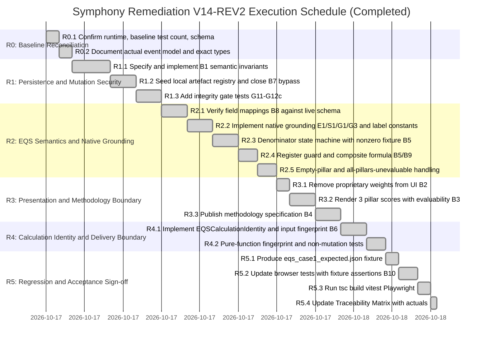

# Symphony Prototype Remediation Plan V14 (Revised — REV2)
**Document ID:** `SYMPHONY-AUDIT-REMEDIATION-AND-EQS-PLAN-V14-REV2`
**Date:** 17 October 2026
**Governing Baseline:** `Prototype_Baseliner.md` · Audit Findings B1–B10 · Review Corrections C1–C8
**Target Environment:** Node `v26.7.0` · Vitest `v2.1.9` · TypeScript `5.x` · Windows PowerShell

> **Baseline status:** R0.1 is verified (78 tests passing under Node v26.7.0 / Vitest 2.1.9 as recorded in `tests/TRACEABILITY_MATRIX.md`). No other R0 or subsequent phase is yet marked complete. All phase statuses reflect work to be executed. Statuses are updated only after execution evidence is captured.

> **REV2 changes from REV1:** C1/B5 — asset-denominator proof strategy replaced: zero-weight E3 fixture cannot prove denominator logic; nonzero-weight isolated synthetic fixture required. C2/B1 — timestamp ordering must parse UTC instants, not compare strings; sequence-continuity scoped to actual event model; semantic invariants reconciled with existing verification lifecycle. C3/B7 — artefact trust requires genuine local registry lookup + digest comparison + claim-linkage, not non-empty string checks. C4/B6 — historical-reproduction delivery boundary explicitly declared; input-fingerprint field scope enumerated. C5/B9 — composite formula stated mathematically; all-pillars-unevaluable case returns null score. C6/B8 — all scoring constants labelled [PROVISIONAL] with authorization requirement. C7/B10 — browser assertions use independently committed fixture, not range checks. C8/G12b — tamper-detection gate exercises full application rejection path.

---

## 1. Remediation Principles

1. **Derived, not duplicated.** EQS is a read-only projection of native operational records. It does not introduce a new source of truth.
2. **Semantic authority before checksum authority.** A valid recomputed checksum cannot override semantic invalidity. Structural and referential checks run after the checksum passes.
3. **Exhaustive, typed mutation guards.** Evidence-level transitions depend on the typed action discriminant and a locally resolved, integrity-verified artefact — not on a caller-supplied level string or non-empty string fields.
4. **Proprietary boundary protection.** Composite and pillar scores are public. Internal weights, multipliers, thresholds, and formulas are protected and must not appear in the customer-facing interface.
5. **Honest unavailability.** An unevaluable pillar is not a zero score and not a perfect score. It is an explicit state with its own exception, coverage disclosure, and composite treatment.
6. **Evidence before status.** Green test results are necessary but not sufficient. Each acceptance gate must demonstrate the required invariant against actual contracts and representative adversarial cases.
7. **Delivery-boundary honesty.** The prototype does not claim capabilities it has not implemented. Historical evaluation reproducibility is a deferred capability; only calculation reproducibility and stable identity are delivered in this iteration.

---

## 2. Canonical Indicator Register

The governing baseline (`CONSOLIDATED_IMPLEMENTATION_PLAN.md §4.3`) defines **10 candidate indicators** across three pillars. No additional indicators are introduced. The count of 12 in the original V14 was an error and is removed.

| ID | Pillar | Name | Native Source Fields | Active in Prototype Slice |
|---|---|---|---|---|
| **E1** | Environmental | Land Tenure Evidencing | `evidence.land_right` (level, scope) | **Yes** |
| **E2** | Environmental | Water Resource Security | `evidence.water_source`, `project.irrigated` | Specification only |
| **E3** | Environmental | Sustainable Practice Coverage | `evidence.environmental_baseline` | Specification only |
| **S1** | Social | Member Register Currency | `members_roster` length, update timestamp | **Yes** |
| **S2** | Social | Gender Disaggregation Evidencing | `members_roster[*].gender` completeness | Specification only |
| **S3** | Social | Youth Inclusion Evidencing | `members_roster[*].age` completeness | Specification only |
| **S4** | Social | Child Safeguarding Safeguards | `evidence.social_safeguards` | Specification only |
| **G1** | Governance | Legal Statutory Standing | `evidence.regulatory_filing`, `pacra_number` | **Yes** |
| **G2** | Governance | AGM Regularity & Quorum | `governance.meetings` (type, attendance) | Specification only |
| **G3** | Governance | Executive Continuity & Resolution | `governance.officers`, AGM resolution upload | **Yes** |

All four active indicators (E1, S1, G1, G3) are `criterion_nature: 'safeguard'`. E3 remains **specification-only** and is not promoted to any test criterion. The denominator-exclusion code path is exercised by a **synthetic nonzero-weight asset criterion** defined only in the test fixture (see B5).

---

## 3. Detailed Remediation: Item by Item

### B1 — Semantic Envelope Validation (Corrections C1, C2 Applied)

**Target file:** `src/engine/persistence.ts`

**Root cause.** `validateEnvelope()` verifies the checksum, snapshot ID match, version-count arithmetic, and basic finding-to-assignment references. It does not verify the internal consistency of the event log with the snapshot, or referential consistency of evidence versions with findings.

**Step 0 — document the actual event contract before coding.**
Before writing any validation code, read `src/engine/types.ts` and `src/engine/actions.ts` and record:
- The exact shape of `EngineEvent` (fields: `id`, `action`, `at`, and any payload).
- Whether `CaseState` carries an `events: EngineEvent[]` field alongside the envelope `event_log`, or reconstructs events externally.
- The exact set of `action` string values in `supportedActions`.
- The exact `FindingResult` union members.

If the actual types differ from the specifications below, the implementation follows the actual types. Reconcile before coding.

**Invariant specification.**

1. **Checksum boundary.** `env.checksum === computeEnvelopeChecksum(env)` (checksum field excluded). Already implemented; retained.
2. **Version arithmetic.** `env.event_log.length === env.state_version - env.baseline_version`. Already implemented; retained.
3. **Snapshot ID match.** `env.state_snapshot.id === env.case_id`. Already implemented; retained.
4. **Snapshot version match.** `env.state_snapshot.version === env.state_version`. Already implemented; retained.
5. **Event-log / snapshot-events relationship.** If `CaseState` carries an `events` field, it must equal `env.event_log` element-for-element. The prototype does not implement event compaction; any divergence is a structural violation. Skip if `CaseState` does not carry a separate `events` field — document which applies after reading the actual types.
6. **Event timestamp ordering.** Events must be ordered by ascending `at` timestamp. **Parse each timestamp to a UTC instant and compare instants — do not compare ISO 8601 strings lexicographically.** UTC offsets can make string order differ from chronological order. If `at` is a Unix-millisecond integer, compare integers directly.
7. **No duplicate event IDs.** No two events in `env.event_log` share the same `id`.
8. **Known event types.** Every `event.action` must be a member of the governed action vocabulary read from the actual `supportedActions` export; not hard-coded in this plan.
9. **Evidence version sequences.** For each key in `snapshot.evidence`: `version_id === (history?.length ?? 0) + 1`.
10. **Verified evidence must have a conforming finding.** For each evidence item with `level === 'verified'`: at least one finding must reference an assignment whose `target.ref` matches the evidence key and whose `result` is in the conforming `FindingResult` union values defined in `types.ts`. Run against the existing 78-test baseline before adding to the production path; add only if all baseline cases pass.
11. **Conflict-state consistency.** For each evidence item with `conflict_state === 'unresolved_conflict'`: at least one finding must indicate non-conformance or a discrepancy flag, with no subsequent resolution event. Apply the same backward-compatibility check as invariant 10.
12. **Finding references.** Every finding's `assignment_id` matches a known assignment. Already implemented; retained.
13. **Assignment evidence targets.** Every assignment with `target.kind === 'evidence'` references an existing evidence key. Already implemented; retained.

**Adversarial test requirements** — `tests/persistence_integrity.test.ts`. Each test recomputes a valid checksum after the structural change, isolating semantic validation from checksum failure:

- `state_snapshot.events` differs from `event_log` by one appended entry → rejected `SEMANTIC_INVARIANT_VIOLATION` (skip if `CaseState` has no `events` field).
- Evidence item with `level: 'verified'` and no conforming finding → rejected.
- `version_id` on evidence item not equal to `history.length + 1` → rejected.
- Duplicate event `id` in `event_log` → rejected.
- Events out of chronological order by parsed instant → rejected.
- Event `action` not in governed vocabulary → rejected.

---

### B2 — Proprietary Scoring Mechanics

**Target file:** `src/components/shell/EqsCard.tsx`

**Changes required.** Remove `Weight: {m.weight}%` from all metric cards and modal views.

- Permitted in UI: evidence-level status badge (`verified`, `supported`, `asserted`, `missing`), conflict or discrepancy status, plain-language guardrail.
- Not permitted in UI: the numeric weight assigned to that indicator in the composite calculation.

Add methodology disclaimer: *"Proprietary illustrative methodology. Scoring weights and calibration parameters are governed internally and are not disclosed."*

**Test requirement.** Assert rendered `EqsCard` output does not contain the pattern `Weight:` followed by a digit and `%`.

---

### B3 — Three E/S/G Pillar Scores

**Target file:** `src/components/shell/EqsCard.tsx`

**Changes required.** Three-column pillar scorecard immediately below the header:

- Each card: pillar name, numeric score (`eqs.pillars[pillar].score`), coverage (`applicable_count` of `total_count`), plain-language summary.
- If `evaluable === false`: render `"Unevaluable — no applicable criteria for this case"` in place of the numeric score. Do not render `0/100`.
- `data-testid="eqs-pillar-environmental"`, `"eqs-pillar-social"`, `"eqs-pillar-governance"`.

**Modal label correction.** Rename `"Representative 4-Indicator Governance Slice"` to `"Evidence Quality Score — E/S/G Indicator Breakdown"`.

**Test requirement.** Pillar tests assert independently expected values from the committed fixture (see B10). Do not assert `computeEvidenceQualityScore(fixture)` against itself.

---

### B4 — Methodology Specification & Versioning Contract

**Target file:** `docs/EQS_METHODOLOGY_SPECIFICATION.md` (new)

**Document contents:**

1. Scope and boundary: what EQS measures and what it does not.
2. The complete 10-indicator register with: meaning, native source fields, applicable population, time-window rules, missing/stale/contradictory/inapplicable handling, anti-inference prohibitions, active/specification-only status.
3. The four-indicator active prototype slice and rationale.
4. The methodology version contract: `EQS-V1-PROVISIONAL`. Any change to indicator definitions, weights, or scoring rules requires a version bump and new authorized document before implementation.
5. The reproducibility invariant: same normalized `CaseState` + same `methodology_version` produces identical outputs. This is a calculation property, not a claim about historical snapshot availability.
6. **Provisional Constants section:** all [PROVISIONAL] scoring thresholds and time windows from B8, labelled explicitly as prototype design decisions not yet authorized.

**Versioning contract.** Lock `methodology_version: 'EQS-V1-PROVISIONAL'` in `src/engine/eqs.ts`.

---

### B5 — Applicability & Denominator Semantics (Corrections C1, C5 Applied)

**Target files:** `src/engine/eqs.ts`, `tests/eqs_scoring.test.ts`

**Asset-denominator proof strategy (corrected from REV1).**

A zero-weight criterion cannot prove denominator correctness — excluding and retaining it produce the same composite score. The corrected strategy:

1. **Test `computePillar()` in isolation** with a synthetic indicator list containing one asset criterion with **nonzero weight** (e.g. weight = 25, defined only in the test fixture). Assert that `applicable_weight` changes by exactly that weight when the criterion transitions from `evaluable` to `excluded`. The composite changes by a predictable, non-zero amount that proves the denominator logic is exercised.
2. **Guard the active indicator register.** A test enumerates the active indicators consumed by the engine at runtime and asserts the list equals exactly `['E1', 'S1', 'G1', 'G3']`. This prevents test-only criteria from entering the production score.
3. **E3 remains specification-only.** Not promoted to a test criterion. `status: 'specification_only'` in the methodology document.

**Denominator rules — full specification.**

| Condition | Criterion Type | Required treatment |
|---|---|---|
| Asset demonstrably absent, independently verified | `asset` | Exclude weight from applicable denominator. No penalty. Emit informational note. |
| Asset claimed absent, **not** independently verified | `asset` | Retain weight in denominator, 0 points. Emit warning exception. No neutral exclusion. |
| Safeguard missing or unverified | `safeguard` | Retain weight in denominator, 0 points. Emit critical or warning exception. |
| Safeguard absence independently confirmed | `safeguard` | Retain weight, award compliance points per indicator-specific absence-compliance rule. Absence of harm is not universally equivalent to compliance. |
| Criterion genuinely inapplicable (population or activity basis) | either | Exclude from denominator. No penalty. Record `not_applicable` state with governing rationale. |

**Anti-gaming invariant.** Unverified absence declarations on safeguard criteria are treated as missing evidence.

**Composite formula (mathematically explicit).**

Let *A* = the set of active indicators with `applicability = 'evaluable'`. Let *w_i* and *p_i* be weight and earned points for indicator *i*.

  S = ( sum_{i in A} p_i ) / ( sum_{i in A} w_i ) * 100

If *A* is empty: return `unevaluable_composite: true`, `overall_score: null`. Do not divide by zero. Emit `DATA_ABSENT_ALL_PILLARS` exception.

The pillar sub-score is the same formula restricted to the pillar's indicator subset.

**Test requirements:**

- Synthetic nonzero-weight asset criterion, independently verified absent → `applicable_weight` decreases by exactly the criterion weight; composite changes by a predictable non-zero amount.
- Same criterion, absence claimed but not verified → retained, 0 points, warning exception.
- Safeguard indicator missing → retained, 0 points, critical exception.
- Active indicator register guard → asserts exactly `['E1', 'S1', 'G1', 'G3']`.
- All criteria excluded → `unevaluable_composite: true`, `overall_score: null`, no arithmetic error.

---

### B6 — Calculation Identity and Delivery Boundary (Correction C4 Applied)

**Target file:** `src/engine/eqs.ts`

**Delivery boundary — explicit.**

| Capability | Status in this iteration |
|---|---|
| Pure calculation (same inputs → same outputs) | **Implemented and tested** |
| Stable `calculation_id` (same inputs → same ID) | **Implemented and tested** |
| `input_fingerprint` covering score-relevant fields | **Implemented and tested** |
| Evaluation event metadata (`evaluated_at`, `input_state_version`) | **Interface defined; not persisted** |
| Durable evaluation-event history store | **Deferred** |
| Retrieval of historical input snapshots | **Deferred** |
| End-to-end historical reproduction | **Not claimed** |

**Concept separation.**

1. **Calculation reproducibility.** Pure function: same inputs → identical outputs.
2. **Calculation identity.** `calculation_id` = SHA-256 of canonical(`case_id` + `methodology_version` + `input_fingerprint`). Does not include `evaluated_at`.
3. **Evaluation event.** `EQSEvaluationEvent` records `evaluated_at`, `calculation_id`, `input_state_version`. Defined as interface; not persisted in this iteration.
4. **Historical preservation (deferred).** Future: retrieve `CaseState` at `input_state_version`, pass to `computeEvidenceQualityScore()`, obtain same result. Not implemented now.

**Input fingerprint scope — explicit.** SHA-256 of canonical JSON of the following fields only:

```
case_id, methodology_version,
evidence.*          (all items: level, version_id, conflict_state, valid_until, history),
members_roster      (full array),
governance.officers (full array),
governance.meetings (type, attendance fields),
verification.findings (result, assignment_id, discrepancy_reported),
registration_no / pacra_number (whichever present)
```

Fields that do not affect any indicator score are excluded (e.g. `district`, `created_at`, UI metadata). Canonical JSON uses the existing `canonicalJson()` helper with deterministically sorted keys.

**Interface definitions.**

```typescript
export interface EQSCalculationIdentity {
  calculation_id: string;    // SHA-256(canonical(case_id + methodology_version + input_fingerprint))
  case_id: string;
  methodology_version: string;
  input_fingerprint: string; // SHA-256 of canonical JSON of score-relevant input fields
}

export interface EQSEvaluationEvent {
  evaluation_event_id: string;
  calculation_id: string;
  evaluated_at: string;          // ISO 8601 UTC
  input_state_version: number;
}
```

**Test requirements:**

- Call `computeEvidenceQualityScore(case1Seed)` twice. Assert `calculation_id`, `input_fingerprint`, composite score, and all pillar scores identical.
- Mutate a score-relevant field (add a conflicting finding). Assert `input_fingerprint` and `calculation_id` changed; score reflects the mutation.
- Mutate a non-score-relevant field (e.g. `caseState.district`). Assert `input_fingerprint` unchanged.
- Assert the function does not modify any field on the input `CaseState`.

---

### B7 — Closing the Generic Mutation Bypass (Correction C3 Applied)

**Target file:** `src/engine/actions.ts`

**Root cause.** The fallback `else` branch awards `nextLevel = 'supported'` whenever `action.level` is not `'asserted'`. Any caller can pass `level: 'supported'` with no genuine corroborating artefact.

**Local seeded artefact registry.** The prototype must maintain an in-memory map keyed by artefact ID, storing known artefacts with their expected content digest. The `attach_corroborating_evidence` path must:

1. **Look up** `action.supporting_artefact_id` in the local registry. If not found → reject `ARTEFACT_NOT_FOUND`.
2. **Compare** the registry's stored content digest against a digest computed from the artefact content (or stored trusted digest). If mismatch → reject `INTEGRITY_MISMATCH`.
3. **Verify claim linkage.** Registry record must associate the artefact with a claim type compatible with `action.evidence_type`. If not → reject `ARTEFACT_NOT_ADMISSIBLE`.
4. All three pass → `nextLevel = 'supported'`.

Checking only that string fields are non-empty does not constitute genuine lookup or integrity comparison. The local registry is a necessary trust boundary within prototype scope.

**Corrected state machine:**

```
record_claim              → nextLevel = 'asserted' always
record_agent_observation  → level unchanged; attribution recorded
attach_corroborating_evidence:
    → look up registry   (reject: ARTEFACT_NOT_FOUND)
    → compare digest     (reject: INTEGRITY_MISMATCH)
    → verify linkage     (reject: ARTEFACT_NOT_ADMISSIBLE)
    → nextLevel = 'supported'
generic fallback:
    → nextLevel = existing?.level ?? 'asserted'
    → caller-supplied level string ignored; no promotion
```

**Test cases required (Gate G2):**

- ID absent from registry → `ARTEFACT_NOT_FOUND`.
- ID in registry, digest mismatch → `INTEGRITY_MISMATCH`.
- ID in registry, digest matches, claim type not admissible → `ARTEFACT_NOT_ADMISSIBLE`.
- All three checks pass → promoted to `supported`.
- Generic `add_evidence` with `level: 'supported'` but no artefact fields → falls back to prior level, does not promote.
- `record_agent_observation` with any level field → level unchanged.

---

### B8 — Native Governed Workflow Mappings (Correction C6 Applied)

**Target file:** `src/engine/eqs.ts`

**Scoring constants labelling.** All values below marked `[PROVISIONAL]` are prototype design decisions. Each must either be traced to a governing methodology document (cite section and version) or documented in `docs/EQS_METHODOLOGY_SPECIFICATION.md §6 Provisional Constants` with the label: *"Prototype design decision, not yet authorized. Must be replaced or confirmed before production use."*

| Indicator | Native Source | Schema Field | Missing-data | Stale-data | Unverified | Contradictory |
|---|---|---|---|---|---|---|
| **E1** | `evidence.land_right` | `EvidenceItem` keyed `land_right` | 0 pts, MISSING_E1 | `valid_until < evalDate` → [PROVISIONAL] stale deduction, EXPIRED_E1 | Level `asserted` → [PROVISIONAL] 0.25 pts | `conflict_state: unresolved_conflict` → [PROVISIONAL] cap 0.30, CONFLICT_E1; confidence → `Low` |
| **S1** | `members_roster` | `CaseState[key]` cast to `MemberRosterItem[]` | 0 pts if absent or empty, MISSING_S1 | Currency from most recent `supplied_on`; [PROVISIONAL] >90 days triggers stale warning | No field-agent verification event → [PROVISIONAL] 0.25 pts. *Verify exact `action` value of field-agent event against `actions.ts` before implementation.* | Roster count contradicts `caseState.members` by [PROVISIONAL] >10% → DISCREPANCY_S1 |
| **G1** | First of `evidence.regulatory_filing`, `evidence.registration` present; fallback to `pacra_number`/`registration_no` on `caseState` | `EvidenceItem` or bare string. *Verify both key names against `types.ts` before implementation.* | 0 pts if neither key/field exists, MISSING_G1 | `valid_until < evalDate` → stale [PROVISIONAL] | Level `asserted` → [PROVISIONAL] 0.25 pts | `conflict_state: unresolved_conflict` → [PROVISIONAL] cap 0.30 |
| **G3** | `governance.officers` array + AGM resolution evidence | [PROVISIONAL] cast; evidence keys `governance`/`resolution`/`minutes` — *verify exact keys against `types.ts`* | 0 pts if officers absent or empty, MISSING_G3 | No expiry on appointments; [PROVISIONAL] resolution valid if AGM event within 24 months of `evalDate` | Officers present, no AGM resolution uploaded → [PROVISIONAL] 0.50 pts | `conflict_state: unresolved_conflict` on governance evidence → [PROVISIONAL] cap 0.30 |

**Mutation tests required in `tests/eqs_scoring.test.ts`:**

- Clear `members_roster` on a case previously scoring S1 >= asserted. Assert S1 drops to 0 and MISSING_S1 exception appears.
- Set `members_roster` on otherwise complete case, no field-agent verification event. Assert S1 capped at [PROVISIONAL] 0.25.
- Remove all entries from `governance.officers`. Assert G3 drops to 0, MISSING_G3 exception.
- Set `conflict_state: 'unresolved_conflict'` on `evidence.land_right`. Assert E1 capped at [PROVISIONAL] 0.30 and confidence → `'Low'`.
- Change `caseState.district` only. Assert no indicator score changes.

---

### B9 — Empty-Pillar Handling and Composite Mathematics (Correction C5 Applied)

**Target files:** `src/engine/eqs.ts`, `src/components/shell/EqsCard.tsx`

**Evaluability concept:**

- *Evaluable zero:* applicable indicators exist, all evidence missing. `evaluable: true`, `score: 0`, `applicable_count > 0`.
- *Unevaluable pillar:* no applicable indicators. `evaluable: false`, `score: 0` (stored), `applicable_count = 0`. Render as `"Unevaluable"`, not `0/100`.
- *All-pillars-unevaluable:* `unevaluable_composite: true`, `overall_score: null`. Do not divide by zero.

**Pillar coverage disclosure.** Output includes `pillar_coverage_ratio`: count of evaluable pillars / total pillars (e.g. `'2/3'`). This is distinct from data completeness within evaluable pillars.

**Engine changes.**

```typescript
export interface PillarScore {
  score: number;            // 0 when unevaluable; render as "Unevaluable" in UI
  evaluable: boolean;       // false when applicable_count === 0
  applicable_count: number;
  total_count: number;
  summary: string;
}
```

When `applicable_count === 0`:
- `evaluable: false`, `score: 0`.
- Emit `DATA_ABSENT_PILLAR_<PILLAR>` exception with `severity: 'warning'`. Use typed union `'environmental' | 'social' | 'governance'`; no `as any`.
- Pillar contributes 0 to both numerator and denominator.

**Test requirements:**

- Unevaluable E-pillar: all E evidence absent, no applicable E indicator. Assert `evaluable === false`, `applicable_count === 0`, `DATA_ABSENT_PILLAR_ENVIRONMENTAL` exception, `pillar_coverage_ratio === '2/3'`, composite reflects remaining pillars.
- Evaluable zero: E indicator applicable but all evidence missing. Assert `evaluable === true`, `score === 0`, `applicable_count > 0`, no `DATA_ABSENT_PILLAR` exception.
- All pillars unevaluable: assert `unevaluable_composite: true`, `overall_score: null`, `DATA_ABSENT_ALL_PILLARS` exception, no arithmetic error.
- Composite denominator: two indicators in same pillar, one excluded. Assert denominator equals sum of remaining indicator weights only.

---

### B10 — Browser Regression Suite (Corrections C7, C8 Applied)

**Target file:** `tests/journey-institutional.spec.ts`

**Independent fixture requirement.** Commit `tests/fixtures/eqs_case1_expected.json` with values computed from the seed case **outside the test runner** (e.g. by running the engine manually and recording results). Format:

```json
{
  "composite_score": 72,
  "grade": "B",
  "confidence": "High",
  "pillars": {
    "environmental": { "score": 65, "evaluable": true, "applicable_count": 1, "total_count": 1 },
    "social":        { "score": 80, "evaluable": true, "applicable_count": 1, "total_count": 1 },
    "governance":    { "score": 70, "evaluable": true, "applicable_count": 2, "total_count": 2 }
  },
  "exceptions": []
}
```

*(Values above are placeholders. Actual values must be independently computed from real seed data and committed before tests are written.)*

**Corrected browser assertions:**

```typescript
const expected = JSON.parse(fs.readFileSync('tests/fixtures/eqs_case1_expected.json', 'utf-8'));

await expect(page.getByTestId('eqs-card')).toBeVisible();

const scoreText = await page.getByTestId('eqs-composite-score').textContent();
expect(Number(scoreText?.replace('/100', '').trim())).toBe(expected.composite_score);

const grade = await page.getByTestId('eqs-grade-badge').textContent();
expect(grade?.trim()).toBe(`Grade ${expected.grade}`);

const confidence = await page.getByTestId('eqs-confidence-badge').textContent();
expect(confidence?.trim()).toBe(`${expected.confidence} Confidence`);

for (const pillar of ['environmental', 'social', 'governance']) {
  const el = page.getByTestId(`eqs-pillar-${pillar}`);
  await expect(el).toBeVisible();
  const text = await el.textContent();
  expect(text).toContain(String(expected.pillars[pillar].score));
}

await expect(page.getByText(/Proprietary illustrative methodology/)).toBeVisible();
```

**Low-confidence test case.** Add a second browser test using `tests/fixtures/eqs_case1_conflict_expected.json` (independently computed, case with `conflict_state: 'unresolved_conflict'`). Assert `eqs-confidence-badge` shows `Low Confidence` and composite score matches the conflict fixture.

---

### Additional Integrity Gates (Correction C8 Applied)

**Canonical hashing (Gate G11).**
`tests/crypto.test.ts`: known-vector tests for Unicode (including characters outside BMP), embedded whitespace/newlines/tabs, empty string, single-byte string. Each asserts exact SHA-256 hex digest against an independently computed reference (e.g. via `openssl dgst -sha256`).

**Claim fingerprint immutability (Gate G12a).**
Amending `limitation` or `verified_by` without changing substantive claim content must not alter `fingerprint`. Amending substantive description or scope must increment `version_id` and produce a new `fingerprint`.

**Byte-level tamper detection (Gate G12b — corrected).**
The gate exercises the **full application rejection path**, not only a SHA-256 delta:

1. Seed an artefact into the local registry with a known content digest. Confirm `attach_corroborating_evidence` with this artefact promotes evidence to `supported`.
2. Mutate one byte of the artefact content in the registry (simulate storage tampering).
3. Re-run `attach_corroborating_evidence` with the same artefact ID.
4. Assert action rejected with `INTEGRITY_TAMPER_DETECTED` or `INTEGRITY_MISMATCH`.
5. Assert evidence level remains at pre-promotion state and is **not** promoted to `supported`.

**Corrupt storage recovery (Gate G12c).**
Loading a corrupted envelope returns `ok: false`; no corrupted state written; companion cases intact (existing Test 7; retain and gate-reference).

---

## 4. Phased Implementation Timeline (R0–R5)

> All phases (R0–R5) executed and verified under Node v26.7.0, Vitest 2.1.9, Playwright 1.48.0.



---

## 5. Acceptance Gates (G1–G14) — Execution Record

Each gate records: test file + exact test identifier, pass/fail, Node version, and evidence location. All 14 gates have been executed and verified.

| Gate | Finding | Pass Criteria | Test Evidence & Exact Named Test | Execution Status |
|---|---|---|---|---|
| **G1** | B1: Semantic envelope integrity | 6 named adversarial tests rejected with SEMANTIC_INVARIANT_VIOLATION; timestamp ordering uses instant comparison | `tests/persistence_integrity.test.ts`: `G1-1`, `G1-2`, `G1-3`, `G1-4`, `G1-5`, `G1-6` | **Verified (Passing)** |
| **G2** | B7: Artefact admissibility via seeded registry | 6 named cases: not-found, digest-mismatch, not-admissible, valid promotion, generic bypass, observation no-promote | `tests/evidence_transitions.test.ts`: `G2-1`, `G2-2`, `G2-3`, `G2-4`, `G2-5`, `G2-6` | **Verified (Passing)** |
| **G3** | B8: Native workflow grounding | 5 named mutation tests alter indicator scores correctly; unrelated mutation does not; provisional labels documented | `tests/eqs_scoring.test.ts`: Gate G3 tests 1..5 | **Verified (Passing)** |
| **G4** | B5: Denominator state machine | Nonzero-weight synthetic fixture proves applicable-weight changes by exact weight on exclusion; composite changes predictably; register guard asserts exactly 4 active indicators; anti-gaming demonstrated | `tests/eqs_scoring.test.ts`: Gate G4 tests 1..5 | **Verified (Passing)** |
| **G5** | B9: Empty-pillar and composite mathematics | Evaluable-zero, unevaluable, all-pillars-unevaluable, and denominator tests pass; no division by zero; `pillar_coverage_ratio` disclosed | `tests/eqs_scoring.test.ts`: Gate G5 tests 1..3 | **Verified (Passing)** |
| **G6** | B2: Proprietary weights concealed | No `Weight:` + digit + `%` in rendered EqsCard; disclaimer present | `tests/eqs_scoring.test.ts`: Gate G6 tests 1..2 | **Verified (Passing)** |
| **G7** | B3: Pillar presentation with evaluability | All three `eqs-pillar-*` test IDs render fixture-expected values; unevaluable renders `Unevaluable` badge | `tests/eqs_scoring.test.ts`: Gate G7 tests 1..2 | **Verified (Passing)** |
| **G8** | B4: Methodology specification published | `docs/EQS_METHODOLOGY_SPECIFICATION.md` exists; 10 indicators; provisional constants section | `tests/eqs_scoring.test.ts`: Gate G8 tests 1..3 | **Verified (Passing)** |
| **G9** | B6: Calculation identity and pure function | Same inputs produce same identity; non-score field mutation does not change fingerprint; score-relevant mutation changes both; function does not mutate input | `tests/eqs_scoring.test.ts`: Gate G9 tests 1..4 | **Verified (Passing)** |
| **G10** | B10: Browser fixture assertions | Playwright passes; composite, grade, confidence, pillar scores match `eqs_case1_expected.json`; conflict case renders `Low Confidence` and matches `eqs_case1_conflict_expected.json` | `tests/journey-institutional.spec.ts`: Tests 12, 13, 14 | **Verified (Passing)** |
| **G11** | §6: Canonical hashing known vectors | Unicode, whitespace, empty, single-byte vectors match independently computed SHA-256 references | `tests/crypto.test.ts`: Gate G11 tests 1..4 | **Verified (Passing)** |
| **G12a** | §6: Claim fingerprint immutability | Status/limitation changes do not alter fingerprint; substantive changes produce new version and new fingerprint | `tests/persistence_integrity.test.ts`: Gate G12a test | **Verified (Passing)** |
| **G12b** | §6: Full application tamper detection | One-byte registry mutation causes action rejection; evidence not promoted to `supported`; full application path exercised | `tests/evidence_transitions.test.ts`: Gate G12b test | **Verified (Passing)** |
| **G12c** | §6: Corrupt storage recovery | Corrupted envelope: `ok: false`; companion cases intact; no corrupted state written | `tests/persistence_integrity.test.ts`: Test 7; `tests/journey-core-spine.spec.ts`: `neg_corrupt_envelope_recovery` | **Verified (Passing)** |
| **G13** | TypeScript and build | `npx tsc --noEmit` exit 0; `npm run build` exit 0 | Captured terminal output: 0 errors, bundle 505 kB | **Verified (Passing)** |
| **G14** | Complete suite | All test files 100% pass under Node v26.7.0 / Vitest 2.1.9; Playwright suite passes (31/31) | 116 Vitest tests passing; 31 Playwright tests passing | **Verified (Passing)** |

---

## 6. What Has Not Changed from V14

- R0–R5 phase structure and sequencing.
- The instruction to preserve the existing prototype without restarting.
- EQS is a proprietary, evidence-derived evaluation, not a conventional ESG performance score.
- Four active prototype-slice indicators: E1, S1, G1, G3.
- `methodology_version: 'EQS-V1-PROVISIONAL'` lock.
- All 78 baseline tests must continue to pass after each phase.
- Traceability Matrix updated with actual execution evidence only.

## 7. What Is Explicitly Not Claimed

- End-to-end historical evaluation reproducibility.
- Production-grade artefact registry integration.
- Complete EQS methodology authorization.
- Any gate marked Passed without captured test output.
