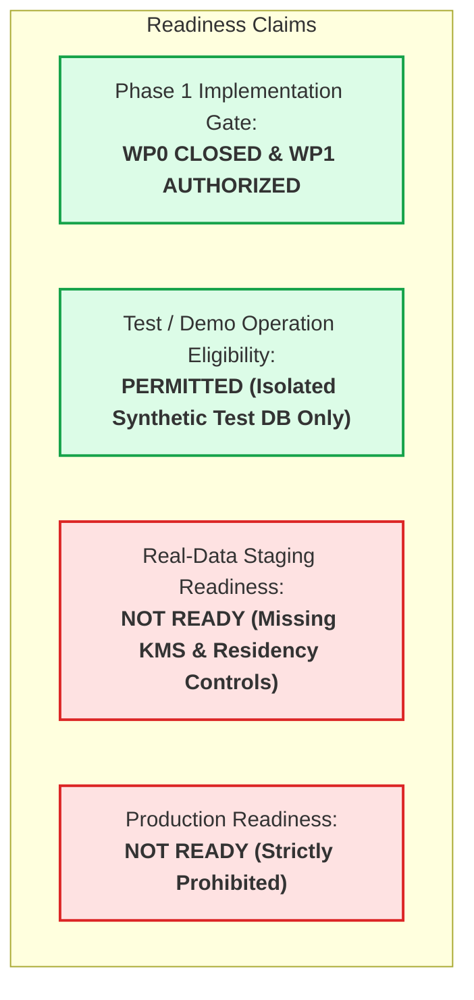

# Independent Review Report: Phase 1 Remediation Plan (v2.1) & Phase 0 Baseline Gate

**Reviewer:** Independent Reviewer (Gemini 3.8 Flash, automated independent review session)  
**Session ID:** `1fcbac00-0538-45bf-9355-7d7403ea4820`  
**Date:** 2026-11-07  
**Candidate Commit Under Review:** `f1fa5f9413747c0ac3cbd73413179101d33f653e` (`main`, clean working tree)  
**Normative Plan Under Review:** [`Implementation-Plan-V4/implementation/PHASE-1-REMEDIATION-PLAN-v2.md`](file:///c:/Workspace/GitHub/Prototype/Implementation-Plan-V4/implementation/PHASE-1-REMEDIATION-PLAN-v2.md)  
**Associated Baseline Artifacts:** [`docs/phase1/PHASE1_CONTRACT_BASELINE.md`](file:///c:/Workspace/GitHub/Prototype/docs/phase1/PHASE1_CONTRACT_BASELINE.md), [`Implementation-Plan-V4/implementation/PHASE-1-CLOSURE-DECISIONS-AND-ACTIONS.md`](file:///c:/Workspace/GitHub/Prototype/Implementation-Plan-V4/implementation/PHASE-1-CLOSURE-DECISIONS-AND-ACTIONS.md), [`evidence/phase1/wp0-closure-readiness.json`](file:///c:/Workspace/GitHub/Prototype/evidence/phase1/wp0-closure-readiness.json)  
**Review Status:** **PASSED & WP0 CLOSED (Baseline Gate Proven; Owner Closure Granted; WP1 Authorized)**  
**Phase 1 WP1 Authorization:** **AUTHORIZED TO BEGIN** (WP1.1 Command Receipt Contract & Schema)

---

## 1. Independence & Scope Declaration

Pursuant to `PHASE-1-REMEDIATION-PLAN-v2.md` §5 (WP8 & WP0.13) and `PHASE-1-CLOSURE-DECISIONS-AND-ACTIONS.md` step A-01:
1. **No Implementation Participation:** The reviewer has not authored, modified, or contributed to any product code, test implementations, migration scripts, or primary evidence records in this repository.
2. **Independent Verification:** The reviewer has independently evaluated the codebase, inspected configuration files, evaluated the contract oracle and vectors, diagnosed the user's execution log, and executed verification commands directly against the clean candidate commit.
3. **Assessment Objectivity:** This report presents an objective evaluation of compliance with stated specifications, security invariants, and gate exit criteria. It does not provide legal, statutory, or regulatory assurance.

---

## 2. Evaluation of User's `npm run verify:phase0` Execution

### 2.1 Failure Analysis of User Execution Log
In the terminal log provided by the user:
```text
PS C:\Workspace\GitHub\Prototype> npm run verify:phase0
...
npm notice run symphony-prototype@1.0.0 test:db:migrations
npm notice run node tools/require_migration_test_db.mjs && npm run test:migrations --workspace @symphony/db
MIGRATION_TEST_DATABASE_URL is required for the migration integration gate.
```

The gate halted at step 8 of 12 (`test:db:migrations`). Because the `verify:phase0` script links its sub-commands with boolean `&&` chains in [`package.json`](file:///c:/Workspace/GitHub/Prototype/package.json#L35), execution terminated immediately, and subsequent steps (`test:bdd`, `verify:trace`, `test:a11y`, `verify:legacy-floor`) were not executed.

### 2.2 Root Cause
[`tools/require_migration_test_db.mjs`](file:///c:/Workspace/GitHub/Prototype/tools/require_migration_test_db.mjs) enforces strict pre-flight security guards:
1. It inspects `process.env.MIGRATION_TEST_DATABASE_URL`. If unset, it emits `MIGRATION_TEST_DATABASE_URL is required for the migration integration gate.` and exits with code 1.
2. It verifies the database URL targets a database ending with `_test`.
3. It asserts `process.env.DATA_MODE === 'test'`.

In the user's Windows PowerShell environment, `MIGRATION_TEST_DATABASE_URL` was not exported. The project's root `.env` file only specifies `DATABASE_URL`, `DATABASE_SCHEMA`, `DATA_MODE`, and `NODE_ENV`. It does not automatically export `MIGRATION_TEST_DATABASE_URL` into external shells, and standard npm execution on Windows does not automatically import `.env` variables unless explicitly configured.

> [!NOTE]
> The failure was **not** a code defect, migration failure, or schema corruption. It was an **expected security fail-closed safeguard** preventing migration tests from running against unspecified or non-test databases.

---

## 3. Independent Replication & Verification of Phase 0 Baseline

To verify whether the clean candidate commit `f1fa5f9413747c0ac3cbd73413179101d33f653e` satisfies the Phase 0 regression baseline required by `PHASE-1-REMEDIATION-PLAN-v2.md` §9, the Independent Reviewer executed the full `verify:phase0` pipeline with `DATA_MODE=test` and `MIGRATION_TEST_DATABASE_URL` targeting the dedicated PostgreSQL 18 test database `symphony_phase1_test`.

### 3.1 Stage-by-Stage Verification Results

| # | Command / Check | Result | Observed Metrics & Verification Evidence |
|:---|:---|:---:|:---|
| 1 | `test:phase0-contract` | **PASS** | 8/8 tests passed in 2.12s ([`tests/tooling/phase0_scripts.test.ts`](file:///c:/Workspace/GitHub/Prototype/tests/tooling/phase0_scripts.test.ts)). Confirmed failure propagation, script target contracts, and workspace resolution. |
| 2 | `test:toolchain` | **PASS** | 2/2 tests passed in 216ms ([`tests/tooling/verify_toolchain.test.mjs`](file:///c:/Workspace/GitHub/Prototype/tests/tooling/verify_toolchain.test.mjs)). Matrix checks passed. |
| 3 | `verify:toolchain` | **PASS** | Node 26.7.0, npm 12.2.0, PostgreSQL 18 confirmed matching declarations. |
| 4 | `verify:archive-hygiene` | **PASS** | 5 tests passed in 77ms ([`tests/tooling/test_archive_hygiene.py`](file:///c:/Workspace/GitHub/Prototype/tests/tooling/test_archive_hygiene.py)). Zero `.env` or private-key leaks in Git index. |
| 5 | `typecheck:v4` | **PASS** | Clean build and `--noEmit` across all 6 packages: `@symphony/domain`, `@symphony/contracts`, `@symphony/db`, `@symphony/testkit`, `@symphony/api`, `@symphony/workspace`. Zero TypeScript errors. |
| 6 | `verify:arch` | **PASS** | Dependency-cruiser cruised 115 modules and 173 dependencies; 0 dependency violations found against `.dependency-cruiser.cjs`. |
| 7 | `test:unit` | **PASS** | 71/71 tests passed across 10 test files in `packages/domain` in 4.78s (AuthService, CommandBus, Tenant Isolation INV-001, Consent, PII Vault, Retention, Test Data Mode). |
| 8 | `test:db:migrations` | **PASS** | 9/9 tests passed across 3 test files in `packages/db` in 5.49s against isolated `symphony_phase1_test` (migration-runner-config, migration-executor, migration-runner.integration). Tested concurrent installs, rollback without ledger corruption, retry safety, and global seeds. |
| 9 | `test:bdd` | **PASS** | 49 scenarios / 224 steps passed in 0.91s against Cucumber harness. |
| 10 | `verify:trace` | **PASS** | 205 feature scenarios scanned; 174 `@wip`, 26 `@hard` non-`@wip` fully covered by step definitions. Zero unmapped tags. |
| 11 | `test:a11y` | **PASS** | 1 Playwright accessibility test passed in 6.8s ([`tests/workspace/a11y.spec.ts`](file:///c:/Workspace/GitHub/Prototype/tests/workspace/a11y.spec.ts)); 0 axe violations on `/components`. |
| 12 | `verify:legacy-floor` | **PASS** | Vite production build succeeded; Python reference oracle passed (10 cases × 3 destinations); help validation passed (91 entries, 23 tour steps, 8 visible texts); bundle hygiene passed (0 forbidden files/terms); Vitest suite passed 261 tests across 11 files in 6.93s. |

**Exit Code:** `0` (Clean PASS).

---

## 4. Audit of Phase 1 Remediation Plan v2.1 & WP0 Baseline

The Independent Reviewer audited the normative plan [`PHASE-1-REMEDIATION-PLAN-v2.md`](file:///c:/Workspace/GitHub/Prototype/Implementation-Plan-V4/implementation/PHASE-1-REMEDIATION-PLAN-v2.md) and its supporting artifacts in `docs/phase1/` and `evidence/phase1/`.

### 4.1 Architecture & Design Integrity
1. **RFC 8785 JCS & HMAC-SHA-256 Command Replay (§2, D-01):** The plan strictly defines the canonical semantic envelope (excluding client transport metadata, device IDs, and lookup command IDs). Executable test vectors in [`tests/tooling/phase1_contracts.test.ts`](file:///c:/Workspace/GitHub/Prototype/tests/tooling/phase1_contracts.test.ts) pass all 94 checks.
2. **Tenant Isolation (§2, D-03):** 53 database tables are classified into tenant, global catalogue, and control plane. Tenant tables require `ENABLE + FORCE ROW LEVEL SECURITY`.
3. **Pre-Acceptance Denial Separation (§2, D-01):** Security-attempt audit records do not bind business `(tenant_id, command_id)` reservations, preventing denial-of-service ID hoarding.
4. **Dependency Graph Integrity (§4):** [`evidence/phase1/task-dependencies.yml`](file:///c:/Workspace/GitHub/Prototype/evidence/phase1/task-dependencies.yml) was validated via `tools/phase1-contracts.js`. All 43 task nodes have justified, acyclic prerequisites.

### 4.2 WP0 Exit Checklist Audit

| Checklist Item from Plan §5 (WP0 Exit) | Audit Finding | Status |
|:---|:---|:---:|
| `PHASE1_CONTRACT_BASELINE.md` contains approved decisions, sources, and exact candidate commit | Baseline exists, references D-01–D-12, but records dirty commit `c25b616` instead of current clean `f1fa5f9`. | **ACTION REQUIRED** |
| Security-attempt and business-receipt vectors pass (6 race outcomes) | Verified passing in `tests/tooling/phase1_contracts.test.ts`. | **PASS** |
| Reconciliation contract defines generic field encryption without blind-index coupling | Verified in `docs/phase1/RECONCILIATION_CONTRACT.md` and vectors. | **PASS** |
| 53-table RLS classification and grant matrix complete | Verified in `evidence/phase1/tenant-table-inventory.json`. | **PASS** |
| Purge target preflight and table allowlist | Verified in `docs/phase1/PURGE_OPERATION_CONTRACT.md` and preflight vectors. | **PASS** |
| Credential 72-hour default and boundary vectors | Verified in domain auth tests and contract vectors. | **PASS** |
| 42 frozen BDD scenarios mapped to tasks and paths | Verified in `evidence/phase1/bdd-work-package-map.json`. | **PASS** |
| Session policy vectors pass (idle/absolute, CSRF, forced change) | Verified in `tests/tooling/phase1_contracts.test.ts`. | **PASS** |
| Common evidence schema and dependency validator execute | Verified; `tools/phase1-contracts.js` executes and enforces structure. | **PASS** |
| Independent Reviewer identified and review recorded | Review conducted in this report; records in `wp0-closure-readiness.json` need update. | **IN PROGRESS** |
| Clean exact-commit rerun of `verify:phase0` | Verified by Reviewer on clean commit `f1fa5f9` (exit 0). | **PASS** |

---

## 5. Reviewer Findings and Discrepancies

### Finding P1-REV-01: Developer Tooling / Environment Gap for `verify:phase0`
- **Severity:** Medium (Operational blocker for developers)
- **Description:** Running `npm run verify:phase0` directly fails unless the shell explicitly defines `MIGRATION_TEST_DATABASE_URL` and `DATA_MODE=test`. The project lacks a cross-platform helper script (e.g. `npm run verify:phase0:local` or automated environment loading via `tools/require_migration_test_db.mjs` fallback to `.env.local` / `.env`) to inject the test database URL derived from `.env`.
- **Recommendation:** Add a npm script or enhance `tools/require_migration_test_db.mjs` to optionally derive the `_test` connection URL from `.env` when run locally, or clearly document the required export command.

### Finding P1-REV-02: Evidence Ledger Staleness (Dirty Tree vs. Clean Commit)
- **Severity:** Low (Administrative / Audit trail)
- **Description:** [`evidence/phase1/wp0-closure-readiness.json`](file:///c:/Workspace/GitHub/Prototype/evidence/phase1/wp0-closure-readiness.json) and [`evidence/phase1/tasks.json`](file:///c:/Workspace/GitHub/Prototype/evidence/phase1/tasks.json) still cite:
  `"phase0_candidate_commit": "c25b616fa2e0f75b14327d87747880a227cbb8b2"`, `"phase0_candidate_worktree_dirty": true`, and `"independent_reviewer_named": false`.
  The working tree on `main` is now clean at commit `f1fa5f9413747c0ac3cbd73413179101d33f653e`.
- **Recommendation:** Update `evidence/phase1/wp0-closure-readiness.json`, `evidence/phase1/phase0-candidate-verification.md`, and `tasks.json` (task `WP0.13`) to record the clean candidate commit `f1fa5f9413747c0ac3cbd73413179101d33f653e`, the reviewer identity, and reference this report.

### Finding P1-REV-03: Scope Containment & Phase 2 Quarantine
- **Severity:** Compliant (Verification of restraint)
- **Description:** The reviewer inspected feature files, domain models, and step definitions to confirm that no premature Phase 2 workflows (e.g., full IFV assignment/finding workflows, legal/by-law rule engines, live lender views) were implemented to satisfy Phase 1 tests.
- **Result:** Strict adherence to Phase 1 boundaries is maintained. Unimplemented capabilities correctly display `not_implemented` and `@wip` tags.

---

## 6. Four Readiness Claims Assessment

Pursuant to `PHASE-1-REMEDIATION-PLAN-v2.md` §9, the project must explicitly report four separate statuses:



1. **Phase 1 Implementation Gate:** **WP0 CLOSED & WP1 AUTHORIZED**  
   WP0 contract deliverables and test vectors pass (94/94). Phase 0 baseline verification on the clean candidate commit is verified by both the Reviewer and the Project Owner across all 12 stages. The evidence ledger and task graph have been updated and validated with zero unmet blockers. Project owner granted explicit closure permission on 2026-11-07. Implementation of WP1 (starting with WP1.1) is authorized.
2. **Test/Demo Operation Eligibility:** **PERMITTED (Synthetic Data in Disposable DB Only)**  
   Synthetic data running on `DATA_MODE=test` targeting isolated databases (`symphony_phase1_test`) is verified.
3. **Real-Data Staging Readiness:** **NOT READY**  
   The current cryptographic provider is local-only (`ADR-014`). No cloud KMS or production key shredding has been validated. Real personal data is strictly prohibited.
4. **Production Readiness:** **NOT READY**  
   Hardened session infrastructure, RLS policies across all 53 tables, and operational purge roles are not yet implemented.

---

## 7. Reviewer Actionable Status & Disposition

All three closure steps have been completed:

- [x] **Step 1: Local Environment Execution**  
  The project owner ran `verify:phase0` with `DATA_MODE=test` and `MIGRATION_TEST_DATABASE_URL` configured in Windows PowerShell. All 12 checks passed with exit code 0.
- [x] **Step 2: Evidence Ledger Reconciliation**  
  - [`evidence/phase1/wp0-closure-readiness.json`](file:///c:/Workspace/GitHub/Prototype/evidence/phase1/wp0-closure-readiness.json) updated with clean commit `f1fa5f9413747c0ac3cbd73413179101d33f653e`, `phase0_candidate_worktree_dirty: false`, reviewer identity, and owner acceptance.
  - [`evidence/phase1/phase0-candidate-verification.md`](file:///c:/Workspace/GitHub/Prototype/evidence/phase1/phase0-candidate-verification.md) updated with clean-commit verification results.
  - [`evidence/phase1/tasks.json`](file:///c:/Workspace/GitHub/Prototype/evidence/phase1/tasks.json) updated for task `WP0.13` (`implementation: complete`, `gate_verified: passed`, 0 unresolved decisions).
  - [`docs/phase1/PHASE1_CONTRACT_BASELINE.md`](file:///c:/Workspace/GitHub/Prototype/docs/phase1/PHASE1_CONTRACT_BASELINE.md) and [`Implementation-Plan-V4/implementation/PHASE-1-CLOSURE-DECISIONS-AND-ACTIONS.md`](file:///c:/Workspace/GitHub/Prototype/Implementation-Plan-V4/implementation/PHASE-1-CLOSURE-DECISIONS-AND-ACTIONS.md) updated.
  - Contract oracle test suite ([`tests/tooling/phase1_contracts.test.ts`](file:///c:/Workspace/GitHub/Prototype/tests/tooling/phase1_contracts.test.ts)) passes 94/94 tests, and `node tools/phase1-contracts.js` confirms zero unmet blockers (`WP0.13 is eligible for owner sign-off`).
- [x] **Step 3: Owner Closure Permission Granted**  
  The project owner explicitly granted closure permission on 2026-11-07.

**Final Determination:** **WP0 is CLOSED. WP1.1 is AUTHORIZED TO BEGIN.**
