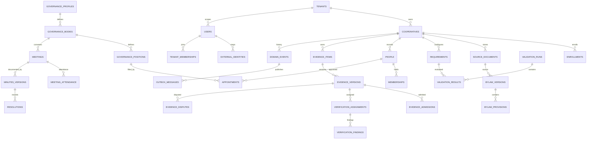

# Symphony Logical Relational ERD

## Entity catalogue

| Domain | Tables | Responsibility |
|---|---|---|
| Identity | `tenants`, `users`, `external_identities`, `tenant_memberships` | Login mapping, tenant access, platform role. Not cooperative authority. |
| Cooperative | `cooperatives`, `enrollments` | Identity, enrollment and handover. |
| Sources | `source_documents`, `bylaw_versions`, `bylaw_provisions`, `requirements` | Versioned sources and source-linked requirements. |
| Governance | `governance_profiles`, `governance_bodies`, `governance_positions` | Configurable by-law-specific structure. |
| People | `people`, `memberships`, `appointments`, `authority_grants` | Domain persons, temporal membership, appointments and delegated authority. |
| Decisions | `meetings`, `meeting_attendance`, `minutes_versions`, `resolutions` | Meeting, attendance, immutable minutes and resolutions. |
| Evidence | `evidence_items`, `evidence_versions`, `evidence_admissions` | Logical item, immutable submissions and separate admission. |
| Assurance | `verification_assignments`, `verification_findings`, `evidence_disputes` | Version-specific verification and dispute. |
| Validation | `validation_runs`, `validation_results` | Immutable evaluation snapshots. |
| Infrastructure | `domain_events`, `command_receipts`, `outbox_messages` | Append-only business history, idempotency and reliable publication. |

## Relationship semantics

- A user is a platform account; a person is a cooperative-domain identity. They are not interchangeable.
- Governance positions are definitions; appointments are time-bounded assignments.
- By-law and minutes versions are preserved, not overwritten.
- Evidence admission, cooperative approval and verification are separate.
- Findings target exact versions.
- Validation results point to exact requirement and run; source/evidence version IDs are snapshotted.
- UI telemetry is not business audit history.

## Constraint notes

- Tenant and cooperative composite FKs must prevent cross-scope references.
- Exclusive appointment overlap requires a PostgreSQL exclusion constraint or serialized command locking the position row.
- Cross-aggregate state transitions require trusted command handlers; FKs alone do not enforce workflow.
- Immutability triggers protect against ordinary application mutation, not superuser tampering.
- Supabase RLS is added later and does not replace action authorization.
